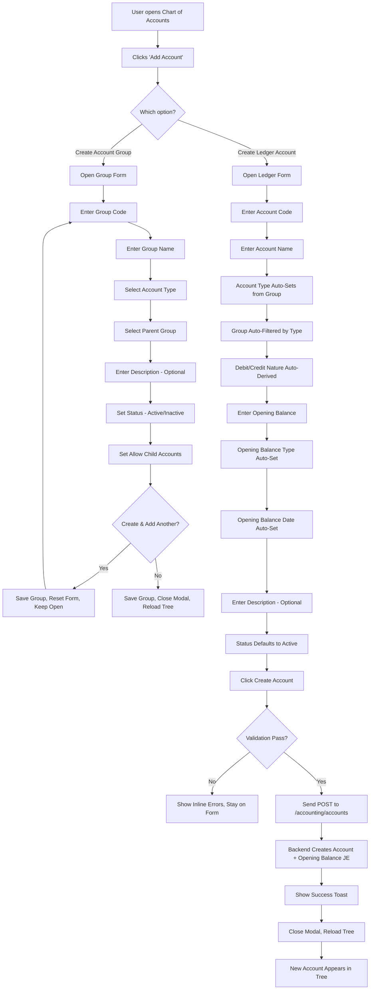
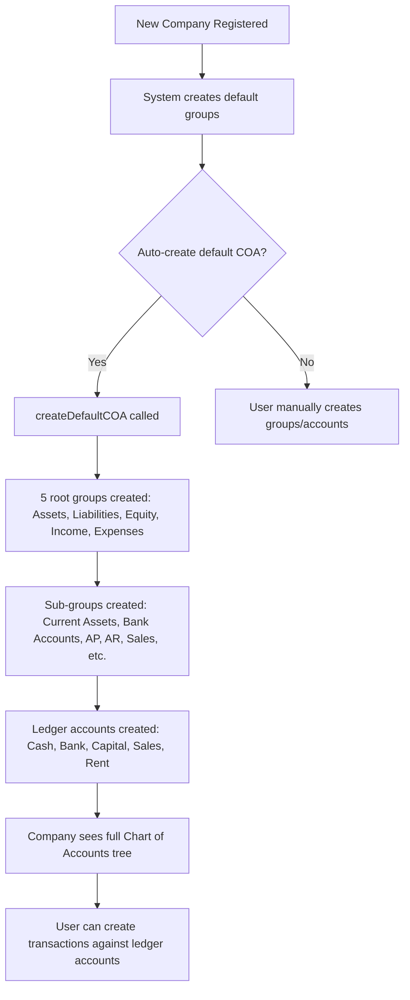

# BLACK START CRM – CHART OF ACCOUNTS & LEDGER ACCOUNT CREATION WORKFLOW

## Detailed Functional & Accounting Workflow Documentation

**Document Version:** 1.0  
**Date:** September 7, 2026  
**Author:** Senior ERP/Accounting Software Architect  
**Status:** Implementation-Ready

---

## 1. EXECUTIVE SUMMARY

This document defines the complete business logic, accounting rules, data model, user interface specification, validation rules, and end-to-end workflow for the **Black Start CRM Chart of Accounts and Ledger Account Creation** system.

The Chart of Accounts (COA) is the foundation of the entire accounting system. Every financial transaction — invoices, bills, payments, journal entries, and reports — ultimately posts to a ledger account that originates from this module. A poorly structured COA leads to:

- Incorrect financial statements
- Audit trail gaps
- Unbalanced books
- Reporting nightmares

### Key Principles

| Principle | Implementation |
|-----------|----------------|
| **Master/Detail Separation** | Account Types and Account Groups are *Masters*; Ledger Accounts are *posting accounts* |
| **Hierarchical Integrity** | Child groups must inherit the type/nature of their parent |
| **No Direct Posting on Groups** | Account Groups cannot receive journal entries; only Ledger Accounts can |
| **Referential Integrity** | Cannot delete groups/accounts with children or transactions |
| **Audit Trail** | Every create/update/delete is logged |
| **Permission-Based Access** | `accounting.manage` for full CRUD, `accounting.view` for read-only |
| **Irreversible Design** | Once `is_group=true`, an account cannot be changed to `allow_direct_posting=true` |

---

## 2. ACCOUNTING ARCHITECTURE

### Chart of Accounts Hierarchy

```
Chart of Accounts
  → Account Type (Master)
    → Account Group (Master, Organizational)
      → Sub Group (Master, Organizational)
        → Ledger Account (Posting Account, Transactional)
```

### Master vs. Transactional Classification

| Object | Type | Editable | Deletable | Receives Journal Entries |
|--------|------|----------|-----------|-------------------------|
| Account Type | Master | Read-only (5 predefined) | No | No |
| Account Group | Master | Yes | Only if no children/transactions | No |
| Sub Group | Master | Yes | Only if no children/transactions | No |
| Ledger Account | Posting | Yes | Only if no transactions | Yes |
| Journal Entry | Transaction | No | No (cancel/reverse only) | Yes (reference) |

### Database Relationship

```
account_types (reference data)
     ↓ (type)
account_groups (parent_id → self, hierarchical)
     ↓ (account_group_id)
accounts (parent_id → self or group, is_group flag)
     ↓ (account_id)
journal_entry_lines
     ↓ (journal_entry_id)
journal_entries
     ↓ (voucher_id)
vouchers
```

---

## 3. CHART OF ACCOUNTS HIERARCHY

### Current Database Structure

#### `account_groups` Table
| Column | Type | Description |
|--------|------|-------------|
| `id` | TEXT (PK) | System-generated unique ID (e.g., `ag_asset`) |
| `company_id` | TEXT | Tenant identifier (default: `'default'`) |
| `code` | TEXT | Display code (e.g., `1000`, `1100`) |
| `name` | TEXT | Human-readable name |
| `parent_id` | TEXT (FK) | References `account_groups.id` — enables sub-groups |
| `type` | TEXT | One of `ASSET`, `LIABILITY`, `EQUITY`, `INCOME`, `EXPENSE` |
| `debit_credit_nature` | TEXT | `DEBIT` or `CREDIT` |
| `description` | TEXT | Optional notes |
| `is_active` | INTEGER | 1 = Active, 0 = Inactive |
| `allow_child_accounts` | INTEGER | 1 = can have children, 0 = leaf group |
| `created_at` | DATETIME | Auto-set |
| `updated_at` | DATETIME | Auto-updated |

**Unique constraint:** `(company_id, code)` — prevents duplicate codes within a company.

#### `accounts` Table
| Column | Type | Description |
|--------|------|-------------|
| `id` | TEXT (PK) | System-generated unique ID (e.g., `acc_cash`) |
| `company_id` | TEXT | Tenant identifier |
| `code` | TEXT | Display code (e.g., `1001`) |
| `name` | TEXT | Account name |
| `account_group_id` | TEXT (FK → account_groups.id) | Parent group |
| `type` | TEXT | `ASSET`, `LIABILITY`, `EQUITY`, `INCOME`, `EXPENSE`, `BANK`, `CASH` |
| `debit_credit_nature` | TEXT | `DEBIT` or `CREDIT` |
| `opening_balance` | REAL | Starting balance amount |
| `opening_balance_type` | TEXT | `DEBIT` or `CREDIT` |
| `opening_balance_date` | TEXT | Date of opening balance entry |
| `description` | TEXT | Optional notes |
| `is_active` | INTEGER | 1 = Active, 0 = Inactive |
| `parent_id` | TEXT (FK → accounts.id) | For sub-accounts within groups |
| `is_group` | INTEGER | 1 = Account Group (organizational), 0 = Ledger (posting) |
| `allow_direct_posting` | INTEGER | 1 = can receive journal entries, 0 = group-only |
| `reconciliation_required` | INTEGER | 1 = requires bank reconciliation |
| `created_at` / `updated_at` | DATETIME | Audit timestamps |

**Unique constraint:** `(company_id, code)` — prevents duplicate account codes.

---

## 4. ACCOUNT TYPE MASTER

### Available Account Types

| # | Account Type | Meaning | Purpose | Examples | Normal Balance | Debit Increase? | Credit Increase? | Financial Statement |
|---|-------------|---------|---------|----------|----------------|-----------------|-----------------|---------------------|
| 1 | **ASSET** | Resources owned/controlled | Track what the business owns | Cash, Bank, Inventory, AR, Equipment | Debit | Yes | No | Balance Sheet (Debit side) |
| 2 | **LIABILITY** | Obligations owed | Track what the business owes | Loans, AP, Credit Card, Taxes Payable | Credit | No | Yes | Balance Sheet (Credit side) |
| 3 | **EQUITY** | Owner's claim/residual interest | Track ownership and retained earnings | Share Capital, Retained Earnings, Drawings | Credit | No | Yes | Balance Sheet (Credit side) |
| 4 | **INCOME** | Revenue earned | Track money earned from operations | Sales Revenue, Service Income, Interest Income | Credit | No | Yes | Profit & Loss (Credit side) |
| 5 | **EXPENSE** | Costs incurred | Track money spent on operations | Rent, Salaries, Utilities, COGS | Debit | Yes | No | Profit & Loss (Debit side) |
| 6 | **BANK** | Bank account (specialized asset) | Track specific bank relationships | SBI Bank Account, HDFC Overdraft | Debit | Yes | No | Balance Sheet (Debit side) |
| 7 | **CASH** | Physical cash (specialized asset) | Track petty cash, cash drawers | Cash in Hand | Debit | Yes | No | Balance Sheet (Debit side) |

### Accounting Rules Enforcement

```javascript
// Nature is automatically derived from type
const nature = type === 'LIABILITY' || type === 'EQUITY' || type === 'INCOME' ? 'CREDIT' : 'DEBIT';
```

| Account Type | Normal Balance | Debit Effect | Credit Effect |
|-------------|---------------|-------------|--------------|
| Asset | Debit | Increase | Decrease |
| Liability | Credit | Decrease | Increase |
| Equity | Credit | Decrease | Increase |
| Income | Credit | Decrease | Increase |
| Expense | Debit | Increase | Decrease |
| Bank | Debit | Increase | Decrease |
| Cash | Debit | Increase | Decrease |

**Financial Statement Impact:**
- **Balance Sheet**: Assets (Debit) vs Liabilities + Equity (Credit)
- **Profit & Loss**: Income (Credit) − Expenses (Debit) = Net Profit/Loss

---

## 5. ACCOUNT GROUP MASTER

Account Groups are **organizational containers** — they structure the Chart of Accounts hierarchically. Groups cannot receive direct journal postings.

### Group Creation Form Fields

| Field | Required | Type | Description |
|-------|----------|------|-------------|
| **Group Code** | ✅ Yes | Text (4-6 digits) | Unique within company. Follows numbering: 1xxx=Asset, 2xxx=Liability, etc. |
| **Group Name** | ✅ Yes | Text (max 100 chars) | Human-readable name |
| **Account Type** | ✅ Yes | Dropdown | One of: ASSET, LIABILITY, EQUITY, INCOME, EXPENSE |
| **Parent Group** | Optional | Hierarchical dropdown | Parent group; must be same type. Excludes self and descendants. |
| **Debit/Credit Nature** | System-set | Text | Auto-derived from type (DEBIT for Asset/Expense, CREDIT for Liability/Equity/Income) |
| **Description** | Optional | Textarea | Internal notes about the group's purpose |
| **Status** | ✅ Yes | Dropdown | Active/Inactive |
| **Allow Child Accounts** | ✅ Yes | Radio | Yes (can have sub-groups/accounts) / No (leaf group) |

### Group Code Structure

| Range | Type | Example |
|-------|------|---------|
| 1000–1999 | Asset | `1000` Assets, `1100` Current Assets |
| 2000–2999 | Liability | `2000` Liabilities, `2100` Current Liabilities |
| 3000–3999 | Equity | `3000` Equity, `3100` Capital |
| 4000–4999 | Income | `4000` Income, `4100` Sales |
| 5000–5999 | Expense | `5000` Expenses, `5100` Salaries |

> **Note:** The numbering system is configurable. The ranges above are the Indian GAAP-recommended default structure.

---

## 6. ACCOUNT GROUP CREATION WORKFLOW

### Workflow Steps

1. **User opens**: Accounting → Chart of Accounts → Add Account → **Create Account Group**
2. **System opens**: Centered modal titled **Create Account Group**
3. **User enters**:
   - Group Code (e.g., `1100`)
   - Group Name (e.g., `Current Assets`)
   - Account Type (e.g., `ASSET`) — dropdown
   - Parent Group (e.g., `1000 - Assets`) — searchable hierarchical dropdown
   - Description (optional)
   - Status (default: Active)
   - Allow Child Accounts (default: Yes)
4. **User clicks**: Create Account Group OR Create & Add Another
5. **System validates**:
   - Code is unique within company
   - Type matches parent group type
   - No circular hierarchy (self/parent/parent's ancestors)
   - Parent group has `allow_child_accounts = 1`
6. **System creates**: Account Group record in `account_groups`
7. **System logs**: Audit entry in `accounting_audit`
8. **System closes**: Modal, reloads tree on Chart of Accounts page

### Frontend Implementation Reference

```javascript
// chart-of-accounts.js — openGroupForm(row)
// Creates a modal with 7 fields: code, name, type, parent_id, description, is_active, allow_child_accounts
// Features:
// - _loadParentGroups() loads parent dropdown, excluding self + descendants
// - Type inheritance: selecting a parent auto-suggests matching type via /suggest/:parentId
// - "Create & Add Another" button for rapid creation
```

---

## 7. ACCOUNT GROUP HIERARCHY

### Hierarchical Rules

| Rule | Description | Enforcement |
|------|-------------|-------------|
| **Same-Type-Only** | A child group must have the same Account Type as its parent | Backend validation in `AccountGroupService.create()` |
| **No Self-Parent** | A group cannot be its own parent | Checked before insert |
| **No Circular References** | Parent cannot be a descendant of the group being moved | `checkCircular()` using recursive CTE |
| **Parent Must Allow Children** | Parent group must have `allow_child_accounts = 1` | Backend validation |
| **Leaf Groups** | Groups with `allow_child_accounts = 0` can still have ledger accounts | Enforced at account creation |
| **Type Inheritance** | `debit_credit_nature` is inherited from parent | Auto-set on creation |

### Example Hierarchy (Indian Accounting)

```
1000  Assets (ASSET, DEBIT)
  │
  ├── 1100  Current Assets (ASSET, DEBIT)
  │   │
  │   ├── 1110  Cash (ASSET, DEBIT)
  │   ├── 1210  Banks (ASSET, DEBIT)
  │   │   ├── 1211  SBI Bank (ASSET, DEBIT)
  │   │   └── 1212  HDFC Bank (ASSET, DEBIT)
  │   └── 1310  Accounts Receivable (ASSET, DEBIT)
  │
  └── 1500  Fixed Assets (ASSET, DEBIT)
      ├── 1510  Building (ASSET, DEBIT)
      └── 1520  Machinery (ASSET, DEBIT)

2000  Liabilities (LIABILITY, CREDIT)
  │
  └── 2100  Current Liabilities (LIABILITY, CREDIT)
      ├── 2110  Accounts Payable (LIABILITY, CREDIT)
      ├── 2120  Taxes Payable (LIABILITY, CREDIT)
      └── 2130  Short-term Loans (LIABILITY, CREDIT)

3000  Equity (EQUITY, CREDIT)
  │
  ├── 3100  Opening Balance Equity (EQUITY, CREDIT)
  └── 3200  Retained Earnings (EQUITY, CREDIT)

4000  Income (INCOME, CREDIT)
  │
  ├── 4100  Sales (INCOME, CREDIT)
  └── 4200  Service Income (INCOME, CREDIT)

5000  Expenses (EXPENSE, DEBIT)
  │
  ├── 5100  Cost of Goods Sold (EXPENSE, DEBIT)
  ├── 5200  Salaries (EXPENSE, DEBIT)
  ├── 5300  Rent (EXPENSE, DEBIT)
  └── 5400  Utilities (EXPENSE, DEBIT)
```

---

## 8. CREATE LEDGER ACCOUNT POPUP

### Modal Structure

```
┌─────────────────────────────────────────────────────────────────┐
│ Create Ledger Account                                         X │
│ ─────────────────────────────────────────────────────────────── │
│                                                                 │
│ Basic Information                                               │
│ ┌────────────┐ ┌──────────────────────────────┐                 │
│ │ Code*      │ │ Name*                         │                 │
│ │ (text)     │ │ (text)                        │                 │
│ └────────────┘ └──────────────────────────────┘                 │
│ ┌────────────────────────┐ ┌────────────┐                      │
│ │ Account Type*          │ │ Group*      │                      │
│ │ (dropdown)             │ │ (dropdown)  │                      │
│ └────────────────────────┘ └────────────┘                      │
│                                                                 │
│ Accounting Configuration                                        │
│ ┌────────────────────┐ ┌────────────┐ ┌────────────┐            │
│ │ Nature             │ │ Opening Bal│ │ OB Type    │            │
│ │ (auto/readonly)    │ │ (number)   │ │ (dropdown) │            │
│ └────────────────────┘ └────────────┘ └────────────┘            │
│ ┌────────────┐ ┌────────────┐ ┌──────────────────┐               │
│ │ OB Date    │ │ Recn Req'd │ │ Description       │               │
│ │ (date)     │ │ (checkbox) │ │ (textarea)        │               │
│ └────────────┘ └────────────┘ └──────────────────┘               │
│                                             [Status dropdown]    │
│ [Cancel] [Create Account]                                      │
└─────────────────────────────────────────────────────────────────┘
```

### Fields Specification

| # | Field | Required | Type | Purpose | Auto-Derived? |
|---|-------|----------|------|---------|---------------|
| 1 | **Account Code** | ✅ | Text | Unique identifier (e.g., `1110`) | No |
| 2 | **Account Name** | ✅ | Text | Human-readable name (e.g., `Cash in Hand`) | No |
| 3 | **Account Type** | ✅ | Dropdown: ASSET, LIABILITY, EQUITY, INCOME, EXPENSE, BANK, CASH | Classification | No |
| 4 | **Account Group** | ✅ | Searchable hierarchical dropdown | Parent group linkage | No |
| 5 | **Debit/Credit Nature** | ✅ | Radio: DEBIT / CREDIT | Normal balance side | ✅ Yes (from type) |
| 6 | **Opening Balance** | ✅ | Number (≥ 0) | Starting balance | No |
| 7 | **Opening Balance Type** | ✅ | Dropdown: DEBIT / CREDIT | Balance side | ✅ Yes (from nature) |
| 8 | **Opening Balance Date** | ✅ | Date | Effective date | ✅ Yes (default: today or FY start) |
| 9 | **Description** | Optional | Textarea | Internal notes | No |
| 10 | **Status** | ✅ | Dropdown: Active / Inactive | Account activation state | ✅ Yes (default: Active) |

---

## 9. ACCOUNT CODE

### Specification
- **Meaning**: A unique identifier for each ledger account within the company
- **Generation**: User-entered (not auto-generated) — allows for meaningful, structured codes
- **Duplicates**: NOT allowed — enforced via `UNIQUE(company_id, code)` database constraint
- **Structure**: Follows the group numbering system with leaf suffixes
- **Validation**:
  - Required
  - Unique within company
  - Alphanumeric only (letters, numbers, hyphens)
  - 2-10 characters
  - Cannot start with underscore (reserved for system use)
  - Cannot contain special characters except hyphen

### Recommended Numbering Structure

| Range | Account Type | Example Code | Example Account |
|-------|-------------|-------------|-----------------|
| 10xx | Cash in Hand | `1001` | Cash in Hand |
| 11xx | Bank Accounts | `1110` | SBI Bank Account |
| 12xx | Receivables | `1210` | Trade Receivables |
| 13xx | Inventories | `1310` | Raw Materials |
| 14xx | Fixed Assets | `1410` | Building & Construction |
| 20xx | Payables | `2001` | Trade Payables |
| 21xx | Taxes Payable | `2110` | GST Payable |
| 22xx | Loans | `2210` | Bank Loan |
| 30xx | Equity | `3001` | Share Capital |
| 31xx | Retained Earnings | `3101` | Retained Earnings |
| 40xx | Sales | `4001` | Sales Revenue |
| 41xx | Other Income | `4101` | Interest Income |
| 50xx | Materials | `5001` | Raw Material Purchases |
| 51xx | Salaries | `5101` | Salaries Expense |
| 52xx | Rent | `5201` | Office Rent |
| 53xx | Utilities | `5301` | Electricity Bill |
| 59xx | Miscellaneous | `5901` | Bank Charges |

> The system supports full configurability — the numbering system can be customized per company.

### Validation Rules
```javascript
// Required check
if (!code || !code.trim()) throw new ValidationError('Account Code is required');

// Uniqueness check
const existing = this.coaRepo.getByCode(code, companyId);
if (existing) throw new ValidationError(`Account code ${code} already exists`);

// Format validation
if (!/^[A-Z0-9][A-Z0-9-]{1,9}$/.test(code)) {
  throw new ValidationError('Account code must be 2-10 alphanumeric characters (letters, numbers, hyphens only)');
}
// Note: Underscores are reserved for testing and should not be used in production
```

---

## 10. ACCOUNT NAME

### Specification
- **Required**: Yes
- **Maximum length**: 100 characters
- **Allowed characters**: Letters (a-z, A-Z), numbers (0-9), spaces, hyphens, parentheses, periods
- **Duplicate handling**: Two accounts can share a name if they have different codes
- **Minimum length**: 2 characters

### Validation
```javascript
if (!name || !name.trim()) throw new ValidationError('Account Name is required');
if (name.trim().length < 2) throw new ValidationError('Account Name must be at least 2 characters');
if (name.trim().length > 100) throw new ValidationError('Account Name exceeds 100 characters');
if (!/^[a-zA-Z0-9\s\-\.()]+$/.test(name)) {
  throw new ValidationError('Account Name contains invalid characters');
}
```

---

## 11. ACCOUNT TYPE

### Dropdown Values

| Value | Display | Description |
|-------|---------|-------------|
| `ASSET` | Asset | Resources owned by the business |
| `LIABILITY` | Liability | Obligations owed by the business |
| `EQUITY` | Equity | Owner's equity/capital |
| `INCOME` | Income | Revenue earned |
| `EXPENSE` | Expense | Operating costs |
| `BANK` | Bank | Bank account (specialized asset) |
| `CASH` | Cash | Physical cash (specialized asset) |

### Relationship: Account Type → Account Group Filtering

When the user changes the Account Type in the ledger form, the Account Group dropdown should automatically filter to show only groups belonging to that type.

```javascript
// Frontend logic — type change filters groups
typeSelect.addEventListener('change', () => {
  const selectedType = typeSelect.value;
  // The backend /accounting/accounts/groups?isActive=1 returns all groups
  // The frontend filters client-side, or the API should support type filtering
  const filtered = groups.filter(g => g.type === selectedType);
  // Render filtered options
});
```

### Type Validation in Backend
```javascript
const VALID_ACCOUNT_TYPES = ['CASH', 'BANK', 'ASSET', 'LIABILITY', 'EQUITY', 'INCOME', 'EXPENSE'];
if (!VALID_ACCOUNT_TYPES.includes(type)) {
  throw new ValidationError('Invalid account type');
}
```

---

## 12. ACCOUNT GROUP

### Behavior When Opening Dropdown

When the user clicks the Account Group dropdown:

1. **If groups exist**: Show them in a searchable, indented hierarchical dropdown
   - Groups are listed by type, sorted alphabetically by code
   - Child groups are indented with `— ` prefix per level
   - Example:
     ```
     [No parent (top-level)]
     No parent (top-level)
     1000 — Assets (ASSET)
     — 1100 - Current Assets (ASSET)
     —  — 1110 - Cash (ASSET)
     —  — 1200 - Bank Accounts (ASSET)
     2000 — Liabilities (LIABILITY)
     ```

2. **If no groups exist**: Show:
   ```
   No Account Groups Available
   + Create Account Group
   ```
   Clicking "+ Create Account Group" opens the group creation popup inline. After creation, returns to the ledger form and auto-selects the new group.

### Frontend Implementation
```javascript
// _loadGroups(selector, selectedId) in chart-of-accounts.js
async _loadGroups(selector, selectedId) {
  const el = document.querySelector(selector);
  const res = await API.get('/accounting/accounts/groups');
  const groups = res?.data?.groups || res?.data?.items || [];
  el.innerHTML = groups
    .filter(g => g.type === 'ASSET' || g.type === 'LIABILITY' || g.type === 'EQUITY' || g.type === 'INCOME' || g.type === 'EXPENSE')
    .map(g => `<option value="${g.id}" ${g.id === selectedId ? 'selected' : ''}>${g.code} - ${g.name} (${g.type})</option>`)
    .join('');
}
```

---

## 13. DEBIT AND CREDIT

### Clarification of Terms

The terms "Debit" and "Credit" have specific accounting meanings. In this system:

| Concept | Field | Purpose | Source |
|---------|-------|---------|--------|
| **Normal Balance Side** | `debit_credit_nature` | Whether the account naturally carries a debit or credit balance | Derived from Account Type |
| **Opening Balance Side** | `opening_balance_type` | Whether the opening balance is on the debit or credit side | User-selectable, validated against nature |
| **Transaction Entry** | N/A (journal entries) | Actual debit/credit amounts posted to the account | Journal Entry form |

### Field: Debit/Credit Nature

- **Purpose**: Indicates the account's normal balance side
- **Auto-derivation**: 
  - `ASSET`, `BANK`, `CASH`, `EXPENSE` → `DEBIT`
  - `LIABILITY`, `EQUITY`, `INCOME` → `CREDIT`
- **User Override**: Allowed in the UI (e.g., a special credit-balance expense), but the backend enforces accounting consistency
- **Backend Enforcement**:
  ```javascript
  const debitCreditNature = type === 'LIABILITY' || type === 'EQUITY' || type === 'INCOME' ? 'CREDIT' : 'DEBIT';
  ```

### Field: Opening Balance Type

- **Purpose**: Specifies which side the opening balance sits on
- **Options**: `DEBIT` or `CREDIT`
- **Default**: Matches `debit_credit_nature`
- **Validation**: The system validates that the opening balance type is consistent with the account's normal balance nature, but allows override for special cases (e.g., contra accounts)

### Accounting Relationship Matrix

| Account Type | Normal Balance | Nature | Opening Balance Type | Example |
|-------------|---------------|--------|---------------------|---------|
| Asset | Debit | DEBIT | DEBIT | Cash ₹50,000 Dr |
| Liability | Credit | CREDIT | CREDIT | AP ₹30,000 Cr |
| Equity | Credit | CREDIT | CREDIT | Capital ₹1,00,000 Cr |
| Income | Credit | CREDIT | CREDIT | Sales ₹5,00,000 Cr |
| Expense | Debit | DEBIT | DEBIT | Rent ₹50,000 Dr |
| Bank | Debit | DEBIT | DEBIT | Bank ₹2,00,000 Dr |
| Cash | Debit | DEBIT | DEBIT | Cash ₹10,000 Dr |

---

## 14. NATURE

### Definition

In this system, **Nature** refers to the **account's normal balance side** — whether it increases with debits or credits. This is stored as `debit_credit_nature` in the database with values `DEBIT` or `CREDIT`.

### Clarification

While some accounting systems use "Nature" to mean account categories (Personal/Real/Nominal, or Debit/Credit nature), in Black Start CRM:

> **Nature = Debit/Credit Normal Balance Side**

This is the most practical and universally understood definition for an ERP system. It directly ties to:

- **Accounting equation**: Debit increases Assets; Credit increases Liabilities/Equity/Income
- **Trial balance**: All debit balances and credit balances must offset
- **Financial statements**: Correct side placement

### Automatic Derivation

| Account Type | Nature (Auto-Derived) |
|-------------|----------------------|
| Asset | DEBIT |
| Bank | DEBIT |
| Cash | DEBIT |
| Expense | DEBIT |
| Liability | CREDIT |
| Equity | CREDIT |
| Income | CREDIT |

### User Override

The system **allows** users to override the nature for special accounting scenarios (e.g., contra assets, contra liabilities). However, when an override is attempted that creates an accounting inconsistency (e.g., setting an Expense account's nature to CREDIT), the system should display a warning:

> **Warning**: Setting the Nature to Credit for an Expense account is unusual. Expense accounts typically have a Debit nature. This may cause issues in financial reporting.

The user can proceed, but the system logs this as a non-standard configuration.

---

## 15. OPENING BALANCE

### Purpose
Opening Balance represents the financial position carried into the accounting system from a previous period or on day-one setup. It is the starting point from which all subsequent transactions are measured.

### When to Enter
- New company setup (day one)
- Mid-year migration from another system
- FY boundary transition (April 1 → previous balances)

### Field Specification

| Attribute | Value |
|-----------|-------|
| **Required** | No (defaults to 0) |
| **Data Type** | Decimal (REAL in SQLite) |
| **Minimum** | 0.00 |
| **Maximum** | No upper limit |
| **Zero Allowed** | Yes |
| **All Account Types** | Yes |
| **Currency** | Company's base currency (₹ for Indian companies) |

### How It Affects the Ledger

1. **Journal Entry Creation**: On account creation with `opening_balance > 0`, the system automatically creates:
   - A Voucher (`OB-<timestamp>`)
   - A Journal Entry with `total_debit = total_credit = opening_balance`
   - Two journal entry lines:
     - **Primary account**: Debit or Credit the opening balance amount
     - **Contra account**: The offset goes to Retained Earnings (Equity) account

2. **Running Balance**: The opening balance is included in all ledger balance calculations (see `getBalance()` in `chart-of-accounts.repository.js`)

3. **Trial Balance**: Appears in the trial balance as the starting balance

### Example: Opening Balance for Bank Account

```sql
-- Journal Entry created automatically:
-- Voucher: OB-<timestamp>, Type: JOURNAL
-- JE: entry_date = opening_balance_date, total_debit = total_credit = 200000.00
-- Line 1: Account = Bank Account (acc_bank), Debit = 200000.00
-- Line 2: Account = Retained Earnings (acc_retained), Credit = 200000.00
```

### Migration for Existing Businesses

For businesses migrating from legacy systems:

1. **Export trial balance** from old system as of the cut-over date
2. **Map accounts** to the new Chart of Accounts
3. **Enter opening balances** during account creation
4. **System creates offset entries** to Retained Earnings automatically
5. **Verify**: Trial balance from old system = trial balance from new system

---

## 16. OPENING BALANCE TYPE

### Specification

| Attribute | Value |
|-----------|-------|
| **Required** | Yes (if opening_balance > 0) |
| **Options** | `DEBIT` or `CREDIT` |
| **Default** | Matches account's `debit_credit_nature` |

### Contextual Validation

| Account Type | Expected OB Type | Warning if reversed? | Example |
|-------------|-----------------|---------------------|---------|
| Asset | DEBIT | Yes | Bank A/c: ₹2,00,000 Dr |
| Liability | CREDIT | Yes | AP A/c: ₹50,000 Cr |
| Equity | CREDIT | Yes | Capital: ₹1,00,000 Cr |
| Income | CREDIT | Yes | Sales: ₹5,00,000 Cr |
| Expense | DEBIT | Yes | Rent: ₹25,000 Dr |
| Bank | DEBIT | Yes | SBI Bank: ₹1,50,000 Dr |
| Cash | DEBIT | Yes | Cash in Hand: ₹10,000 Dr |

### Indian Accounting Examples

| Account | Opening Balance | OB Type | Explanation |
|---------|----------------|---------|-------------|
| Customer Receivable | ₹50,000 | DEBIT | Money owed TO us (Asset) |
| Supplier Payable | ₹30,000 | CREDIT | Money WE owe (Liability) |
| Bank Account | ₹1,00,000 | DEBIT | Money in bank (Asset) |
| Loan Payable | ₹5,00,000 | CREDIT | Loan we owe (Liability) |
| Share Capital | ₹2,00,000 | CREDIT | Owner's investment (Equity) |
| Sales Account | ₹0 | N/A | No opening balance for income |
| Rent Expense | ₹0 | N/A | No opening balance for expenses |

---

## 17. OPENING BALANCE DATE

### Specification

| Attribute | Value |
|-----------|-------|
| **Required** | Yes (if opening_balance > 0) |
| **Default** | Today's date OR financial year start date |
| **Future Dates** | Not allowed (validation error) |
| **Pre-incorporation** | Allowed (for historical migration) |

### Financial Year Relationship (India)

Default financial year: **April 1 – March 31**

| Scenario | Opening Balance Date | Behavior |
|----------|---------------------|----------|
| New company | April 1, 2026 | First day of FY |
| Mid-year migration | Actual migration date | Backdated entries |
| FY transition | April 1 (new FY start) | Carried-forward balances |

### Date Change Impact

If the Opening Balance Date is changed after account creation:

1. The **offsetting journal entry** in the `journal_entries` table is updated
2. The `entry_date` on the voucher and journal entry is updated
3. All historical balance calculations reflect the new date
4. An audit log entry records the change

---

## 18. DESCRIPTION

### Specification

| Attribute | Value |
|-----------|-------|
| **Required** | No |
| **Type** | Textarea (multi-line text) |
| **Max Length** | 500 characters |
| **Purpose** | Internal notes for accountants |

### Usage Guidelines

The Description field should capture information that helps accountants understand the account's purpose, especially during audits or onboarding new team members.

**Examples:**
- *"Current account used for operational business transactions and petty cash expenses."*
- *"Primary checking account with State Bank of India, used for daily business operations and vendor payments."*
- *"Accounts receivable from trade customers, net 30 days. Used for all credit sales transactions."*
- *"Owner's equity account representing share capital contribution. Do not use for personal withdrawals."*

---

## 19. STATUS

### Definition

| Status | Meaning | Behavior |
|--------|---------|----------|
| **Active** | The account can be used in new transactions | Can be selected in journal entries, invoices, bills |
| **Inactive** | The account is locked for new transactions | Cannot be selected in new transactions; existing transactions remain accessible |

### Deletion Policy

> **Accounts with historical transactions are NEVER hard-deleted. They are deactivated instead.**

| Scenario | Action |
|----------|--------|
| Account with 0 transactions | Can be deleted (hard delete) |
| Account with transactions | Deactivated (is_active = 0) |
| Group with children | Cannot be deleted (error message: "Move children first") |
| Group with transactions through descendants | Cannot be deleted (error message: "Accounts under this group have posted journal entries") |

### Backend Enforcement

```javascript
// Delete Account (controller)
const usageCount = this.coaRepo.conn.get(
  'SELECT COUNT(*) as count FROM journal_entry_lines WHERE account_id = ?',
  [account.id]
);
if (usageCount.count > 0) {
  throw new AppError('Cannot delete an account that has accounting transactions. Deactivate it instead.', 'ACCOUNT_IN_USE', 400);
}
```

```javascript
// Delete Group (service)
const childGroups = repo.getChildGroupCount(id, companyId);
if (childGroups > 0) {
  throw new ValidationError('Cannot delete because it contains child groups.');
}
const childAccounts = repo.getChildAccountCount(id, companyId);
if (childAccounts > 0) {
  throw new ValidationError('Cannot delete because it contains child accounts.');
}
if (repo.hasTransactionsThroughChildren(id, companyId)) {
  throw new ValidationError('Cannot delete because descendant accounts have posted journal entries.');
}
```

---

## 20. COMPLETE LEDGER CREATION WORKFLOW

### Step-by-Step Process



### Detailed Steps

**STEP 1**: User navigates to `Accounting → Chart of Accounts`

**STEP 2**: System loads the hierarchical tree from `GET /accounting/accounts/tree`
- Response includes: tree data (nested groups + accounts), summary counts

**STEP 3**: User clicks **Add Account** button (top-right)
- System shows dropdown: **Create Account Group** OR **Create Ledger Account**

**STEP 4**: User clicks **Create Ledger Account**

**STEP 5**: System opens centered modal titled **Create Ledger Account**

**STEP 6**: System calls `GET /accounting/accounts/groups` to populate the Account Group dropdown
- Groups are filtered to only those with `type` in `ASSET`, `LIABILITY`, `EQUITY`, `INCOME`, `EXPENSE` (not BANK/CASH which are account types only)

**STEP 7**: User selects Account Type (e.g., `ASSET`)
- System filters Account Group dropdown to show only ASSET groups
- System auto-sets Debit/Credit Nature to `DEBIT`
- System auto-sets Opening Balance Type to `DEBIT`

**STEP 8**: User selects Account Group (e.g., `1100 - Cash`)
- System auto-derives:
  - `debit_credit_nature` from the group's type
  - `opening_balance_type` matches nature
  - `opening_balance_date` defaults to today or FY start

**STEP 9**: User enters Account Code (e.g., `1001`)
- System checks uniqueness in real-time (debounced)

**STEP 10**: User enters Account Name (e.g., `Cash in Hand`)

**STEP 11**: User enters Opening Balance (e.g., `50000.00`)

**STEP 12**: User enters Opening Balance Date (auto-set, editable)

**STEP 13**: User enters Description (optional)

**STEP 14**: User selects Status (default: Active)

**STEP 15**: User clicks **Create Account**

**STEP 16**: System validates all fields
- Code is unique
- Group belongs to selected type
- Nature is consistent with type
- OB type is consistent with nature
- All required fields filled

**STEP 17**: System sends `POST /accounting/accounts` with payload:
```json
{
  "code": "1001",
  "name": "Cash in Hand",
  "type": "CASH",
  "account_group_id": "ag_cash",
  "is_group": false,
  "allow_direct_posting": true,
  "debit_credit_nature": "DEBIT",
  "opening_balance": 50000.00,
  "opening_balance_type": "DEBIT",
  "opening_balance_date": "2026-04-01",
  "description": "Petty cash for office expenses",
  "is_active": 1
}
```

**STEP 18**: Backend controller creates the account:
- Generates ID (`acc_cash_001`)
- Validates Account Group doesn't allow posting (is_group=true → allow_direct_posting=false)
- Inserts into `accounts` table
- Creates opening balance journal entry (if balance > 0)
- Logs audit entry

**STEP 19**: System shows success message: `"Account created successfully"`

**STEP 20**: System closes modal, reloads tree
- New account appears under the selected group with proper indentation

---

## 21. VALIDATION RULES

### Complete Validation Table

| Field | Required | Data Type | Validation Rule | Error Message | Dependency | Default |
|-------|----------|-----------|----------------|---------------|------------|---------|
| **Account Code** | ✅ | String | 2–10 chars, alphanumeric + hyphen, no underscore prefix, unique per company | `"Account code is required"` / `"Account code must be 2-10 alphanumeric characters"` / `"Account code {code} already exists"` | None | — |
| **Account Name** | ✅ | String | 2–100 chars, alphanumeric + space + special chars | `"Account name is required"` / `"Account name must be at least 2 characters"` / `"Account name exceeds 100 characters"` | None | — |
| **Account Type** | ✅ | String | Must be one of: ASSET, LIABILITY, EQUITY, INCOME, EXPENSE, BANK, CASH | `"Account type is required"` / `"Invalid account type"` | None | ASSET |
| **Account Group** | ✅ | String (ID) | Must exist in company, type must match, group must allow children | `"Please select an account group"` / `"Selected group type does not match account type"` / `"Selected group does not accept child accounts"` | Account Type | ag_asset |
| **Debit/Credit Nature** | ✅ | String | Must be DEBIT or CREDIT | `"Please select Debit or Credit"` / `"Invalid nature selection"` | Account Type | Auto-derived from type |
| **Opening Balance** | ✅ | Number | ≥ 0, numeric | `"Please enter a valid opening balance"` / `"Opening balance cannot be negative"` | None | 0.00 |
| **Opening Balance Type** | ✅ | String | Must be DEBIT or CREDIT | `"Please select opening balance type"` | Nature | Matches nature |
| **Opening Balance Date** | ✅ | Date | Not in future, within company's FY | `"Opening balance date is required"` / `"Opening balance date cannot be in the future"` | None | Today or FY start |
| **Description** | Optional | String | ≤ 500 chars | — | None | '' |
| **Status** | ✅ | String | Active or Inactive | — | None | Active |
| **Reconciliation Required** | Optional | Boolean | Checkbox | — | Account Type (BANK/CASH only) | false |
| **is_group** | System set | Boolean | Always false for ledger accounts | — | — | false |
| **allow_direct_posting** | System set | Boolean | Always true for ledger accounts; always false for groups | — | is_group | true (ledger), false (group) |

### Group-Specific Validation

| Field | Required | Validation Rule | Error Message |
|-------|----------|----------------|---------------|
| **Group Code** | ✅ | Unique per company, alphanumeric | `"Group code is required"` / `"Group code {code} already exists"` |
| **Group Name** | ✅ | 2–100 chars | `"Group name is required"` |
| **Account Type** | ✅ | ASSET, LIABILITY, EQUITY, INCOME, EXPENSE only | `"Invalid account type"` |
| **Parent Group** | Optional | If set: must be same type, must allow children, must not create cycle, must not be self | `"Cannot set parent to same type"` / `"Circular hierarchy not allowed"` |
| **Allow Child Accounts** | ✅ | Boolean | — |

---

## 22. EMPTY-STATE WORKFLOW

### When "Create Ledger Account" is opened and no Account Groups exist

#### Visual Display
```
┌─────────────────────────────────────────┐
│ Create Ledger Account                    │
├─────────────────────────────────────────┤
│ No Account Groups Available              │
│                                          │
│ [ + Create Account Group ]               │
│                                          │
│ After creating a group, it will appear   │
│ automatically in the group dropdown.     │
└─────────────────────────────────────────┘
```

#### Workflow
1. User clicks **+ Create Account Group**
2. System opens a modal with the group creation form
3. User fills in group details
4. User clicks **Create Account Group**
5. System:
   - Saves the group to the database
   - Closes the group creation modal
   - Reopens (or refreshes) the ledger creation modal
   - **Auto-selects the newly created group** in the dropdown
6. User continues filling the ledger form

#### Implementation

```javascript
// When _loadGroups finds empty results:
if (groups.length === 0) {
  el.innerHTML = `
    <option value="" disabled selected>No Account Groups Available</option>
    <option value="create-new" class="text-secondary">
      + Create Account Group
    </option>
  `;
  
  // Listen for selection of "create-new"
  el.addEventListener('change', async (e) => {
    if (e.target.value === 'create-new') {
      e.preventDefault();
      // Open group form within the ledger modal context
      const group = await self.openInlineGroupForm();
      if (group) {
        // Refresh groups and auto-select the new one
        await self._loadGroups('#coa-group-select', group.id);
      }
    }
  });
}
```

---

## 23. DATABASE / MASTER RELATIONSHIP

### Entity-Relationship Diagram

```
┌─────────────┐
│ account_types │ (Reference: ASSET, LIABILITY, EQUITY, INCOME, EXPENSE, BANK, CASH)
└──────┬───────┘
       ↓ (type)
┌──────────────┐          ┌──────────────┐
│ account_groups │◄────────┤ account_groups │
│ (parents)      │   parent_id│ (children)   │
└──────┬────────┘          └──────────────┘
       │ (id)                   Hierarchical
       ↓ (account_group_id)    self-reference
┌──────────────┐          ┌──────────────┐
│ accounts      │◄────────┤ accounts      │
│ (leaf/posting)│   parent_id│ (sub-accounts)│
└──────┬───────┘          └──────────────┘
       │ (account_id)
       ↓
┌──────┴────────────────────────┐
│ journal_entry_lines            │
│ - debit_amount                │
│ - credit_amount               │
└────────┬──────────────────────┘
         │ (journal_entry_id)
         ↓
┌────────┴──────────────────────┐
│ journal_entries               │
│ - total_debit                │
│ - total_credit                │
│ - status (DRAFT/POSTED)      │
└──────────────────────────────┘
```

### Foreign Key Relationships

| Table | Column | References | On Delete |
|-------|--------|-----------|-----------|
| `account_groups.parent_id` | `id` | `account_groups.id` | SET NULL |
| `accounts.account_group_id` | `id` | `account_groups.id` | RESTRICT |
| `accounts.parent_id` | `id` | `accounts.id` | SET NULL |
| `journal_entry_lines.account_id` | `id` | `accounts.id` | RESTRICT |
| `journal_entries.id` | `id` | (self) | — |
| `journal_entry_lines.journal_entry_id` | `id` | `journal_entries.id` | CASCADE |

### Referential Integrity Rules

1. **Cannot delete a group with child groups** → `getChildGroupCount() > 0`
2. **Cannot delete a group with ledger accounts** → `getChildAccountCount() > 0`
3. **Cannot delete a group whose descendants have transactions** → `hasTransactionsThroughChildren()`
4. **Cannot delete an account with journal entries** → `canDelete()` checks `journal_entry_lines`
5. **Cannot change `is_group` on an account with transactions** → `updateAccount` checks `usageCount > 0`

---

## 24. API/BACKEND LOGIC

### Routes

```javascript
// server/routes/accounting.js

// Chart of Accounts Tree
GET    /accounting/accounts/tree              → getAccountTree
GET    /accounting/accounts/summary           → getAccountSummary

// Account Groups (Masters)
GET    /accounting/accounts/groups            → listAccountGroups
GET    /accounting/accounts/groups/suggest/:parentId → suggestGroupType
GET    /accounting/accounts/groups/:id        → getAccountGroup
POST   /accounting/accounts/groups            → createAccountGroup
PUT    /accounting/accounts/groups/:id        → updateAccountGroup
DELETE /accounting/accounts/groups/:id        → deleteAccountGroup

// Ledger Accounts (Posting)
GET    /accounting/accounts                   → listAccounts
GET    /accounting/accounts/gl                → listGLAccounts (posting only)
GET    /accounting/accounts/:id               → getAccount
POST   /accounting/accounts                   → createAccount
PUT    /accounting/accounts/:id               → updateAccount
DELETE /accounting/accounts/:id               → deleteAccount
POST   /accounting/accounts/import           → importAccounts
GET    /accounting/accounts/export           → exportAccounts
POST   /accounting/accounts/default          → createDefaultCOA
```

### Controller: createAccount (Key Logic)

```javascript
async createAccount(req, res, next) {
  const { code, name, type, account_group_id, is_group, allow_direct_posting,
          opening_balance, opening_balance_type, opening_balance_date, ... } = req.body;

  // 1. Validate required fields
  if (!code || !name || !type) throw new ValidationError('code, name, and type are required');

  // 2. Validate account type
  if (!VALID_ACCOUNT_TYPES.includes(type)) throw new ValidationError('Invalid account type');

  // 3. Enforce: Account Groups cannot receive direct postings
  const isGroup = is_group === true || is_group === 'true' || is_group === 1;
  const canPost = isGroup ? false : (allow_direct_posting !== false && ...);

  // 4. Check for duplicate code
  const existing = this.coaRepo.getByCode(code, companyId);
  if (existing) throw new ValidationError(`Account code ${code} already exists`);

  // 5. Prevent circular hierarchy
  if (parent_id && parent_id === id) throw new ValidationError('Account cannot be its own parent');

  // 6. Derive debit/credit nature
  const debitCreditNature = type === 'LIABILITY' || type === 'EQUITY' || type === 'INCOME' ? 'CREDIT' : 'DEBIT';

  // 7. Insert account
  this.coaRepo.conn.prepare(`INSERT INTO accounts ...`).run(/* params */);

  // 8. Create opening balance journal entry if balance > 0
  if (parseFloat(opening_balance) > 0) {
    this.coaRepo.createOpeningBalance(conn, companyId, id, opening_balance, ...);
  }

  // 9. Audit log
  logAudit(conn, companyId, userId, 'account', id, 'CREATE', null, account);

  res.status(201).json(successResponse(account));
}
```

### Controller: createAccountGroup (Key Logic)

```javascript
async createAccountGroup(req, res, next) {
  const context = {
    companyId, userId: req.user?.userId,
    permissions: req.user?.permissions || [],
    sessionId: req.user?.sessionId,
  };

  const data = {
    code: req.body.code,
    name: req.body.name,
    type: req.body.type,
    parent_id: req.body.parent_id || null,
    description: req.body.description || '',
    is_active: req.body.is_active !== undefined ? req.body.is_active : true,
    allow_child_accounts: req.body.allow_child_accounts !== undefined ? req.body.allow_child_accounts : true,
  };

  // Service handles all validation:
  // - Required fields
  // - Unique code
  // - Parent existence
  // - Type inheritance from parent
  // - Circular hierarchy prevention
  // - Self-parent prevention

  const service = new AccountGroupService(this.groupRepo.conn);
  const group = service.create(data, context);
  res.status(201).json(successResponse(group));
}
```

### Service: AccountGroupService.create() (Key Validation)

```javascript
create(data, context) {
  // 1. Permission check
  Authorizer.assertPermission(context, 'accounting.manage');

  // 2. Required fields
  if (!data.code || !data.name || !data.type) throw new ValidationError(...);

  // 3. Valid types
  const validTypes = ['ASSET', 'LIABILITY', 'EQUITY', 'INCOME', 'EXPENSE'];
  const typeUpper = data.type.toUpperCase();
  if (!validTypes.includes(typeUpper)) throw new ValidationError(...);

  // 4. Unique code within company
  const existing = conn.get('SELECT id FROM account_groups WHERE code = ? AND company_id = ?', ...);
  if (existing) throw new ValidationError(`Group Code ${data.code} already exists`);

  // 5. Parent validation
  if (parentId) {
    const parent = repo.findById(parentId, companyId);
    if (!parent) throw new ValidationError('Parent group not found');
    // Type inheritance: child must match parent type
    if (parent.type !== typeUpper) throw new ValidationError(
      `Account Type must match parent group "${parent.name}" (type: ${parent.type})`
    );
    // Nature must match
    if (parent.debit_credit_nature !== nature) throw new ValidationError(
      `Debit/Credit nature must match parent group "${parent.name}"`
    );
  }

  // 6. Self-parent check
  if (parentId && parentId === id) throw new ValidationError('A group cannot be its own parent');

  // 7. Circular hierarchy detection
  if (parentId && repo.checkCircular(id, parentId, companyId)) {
    throw new ValidationError('Circular hierarchy detected');
  }

  // 8. Insert
  conn.prepare('INSERT INTO account_groups ...').run(/* params */);

  // 9. Audit log
  this._audit(context, 'ACCOUNT_GROUP_CREATED', 'ACCOUNT_GROUP', id, null, created);
  return created;
}
```

---

## 25. CHART OF ACCOUNTS DISPLAY

### Tree Structure

```
▼ 1000  Assets                    GROUP     Asset     ₹0.00    Active    ⋮
    ├─ 1100  Current Assets      GROUP     Asset     ₹0.00    Active    ⋮
    │   ├─ 1110  Cash in Hand     LEDGER    Asset     ₹5,000   Active    ⋮
    │   ├─ 1210  SBI Bank         LEDGER    Bank      ₹200,000  Active    ⋮
    │   └─ 1300  Accts Receivable LEDGER    Asset     ₹50,000   Active    ⋮
    └─ 1500  Fixed Assets         GROUP     Asset     ₹0.00    Active    ⋮
        ├─ 1510  Building         LEDGER    Asset     ₹500,000  Active    ⋮
        └─ 1520  Machinery        LEDGER    Asset     ₹150,000  Active    ⋮

▼ 2000  Liabilities               GROUP     Liability ₹0.00    Active    ⋮
    ├─ 2100  Current Liabilities   GROUP   Liability ₹0.00    Active    ⋮
    │   ├─ 2110  Accts Payable     LEDGER   Liability ₹30,000  Active    ⋮
    │   └─ 2120  GST Payable       LEDGER   Liability ₹15,000  Active    ⋮
    │   ├─ 2210  Bank Loan         LEDGER   Liability ₹500,000  Active    ⋮

▼ 3000  Equity                      GROUP     Equity    ₹0.00    Active    ⋮
    ├─ 3100  Share Capital           LEDGER   Equity    ₹200,000  Active    ⋮
    └─ 3200  Retained Earnings        LEDGER   Equity    ₹100,000  Active    ⋮

▼ 4000  Income                      GROUP     Income    ₹0.00    Active    ⋮
    ├─ 4100  Sales Revenue           LEDGER   Income    ₹1,000   Active    ⋮
    └─ 4200  Service Income           LEDGER   Income    ₹500     Active    ⋮

▼ 5000  Expenses                    GROUP     Expense   ₹0.00    Active    ⋮
    ├─ 5100  Cost of Goods Sold      LEDGER   Expense   ₹20,000  Active    ⋮
    ├─ 5200  Salaries                LEDGER   Expense   ₹1,50,000 Active    ⋮
    ├─ 5300  Rent                    LEDGER   Expense   ₹25,000  Active    ⋮
    └─ 5400  Utilities               LEDGER   Expense   ₹8,000   Active    ⋮
```

### Expand/Collapse Behavior

| Element | Default State | Click Action |
|---------|--------------|-------------|
| Root group (e.g., "1000 Assets") | Expanded | Toggle expand/collapse |
| Parent group (e.g., "1100 Current Assets") | Expanded (depth 1) | Toggle expand/collapse |
| Sub-group (depth 2+) | Collapsed | Toggle expand/collapse |
| Ledger accounts | N/A (leaf) | Open row menu ⋮ |

### Row Styling

| Row Type | Background | Font Weight | Row Height |
|----------|-----------|-------------|------------|
| Root Group | `bg-surface-container/30` | 500 (medium) | 52px |
| Parent Group | `bg-surface-container/30` | 500 | 52px |
| Sub Group | `bg-surface-container/30` | 500 | 52px |
| Ledger | `transparent` | 400 (normal) | 48px |
| Inactive | 60% opacity | — | — |

### Column Layout (CSS Grid)

```css
.coa-grid-template {
  display: grid;
  grid-template-columns: 120px minmax(300px, 1fr) 100px 120px 150px 100px 60px;
}
/* Columns: Code | Account Name | Type | Category | Balance | Status | Actions */
```

---

## 26. SAMPLE REAL-WORLD ACCOUNT CREATION

### Example 1: Cash in Hand
| Field | Value |
|-------|-------|
| Account Code | `1001` |
| Account Name | Cash in Hand |
| Account Type | CASH |
| Account Group | 1100 - Cash (ASSET) |
| Debit/Credit Nature | DEBIT |
| Opening Balance | ₹10,000.00 |
| Opening Balance Type | DEBIT |
| Opening Balance Date | 2026-04-01 |
| Description | Petty cash for office expenses |
| Status | Active |

### Example 2: SBI Bank Account
| Field | Value |
|-------|-------|
| Account Code | `1110` |
| Account Name | SBI Bank Account |
| Account Type | BANK |
| Account Group | 1210 - Banks (ASSET) |
| Debit/Credit Nature | DEBIT |
| Opening Balance | ₹2,00,000.00 |
| Opening Balance Type | DEBIT |
| Opening Balance Date | 2026-04-01 |
| Description | Primary operating account with State Bank of India |
| Status | Active |

### Example 3: Customer Receivable
| Field | Value |
|-------|-------|
| Account Code | `1210` |
| Account Name | Trade Receivables |
| Account Type | ASSET |
| Account Group | 1300 - Accounts Receivable (ASSET) |
| Debit/Credit Nature | DEBIT |
| Opening Balance | ₹50,000.00 |
| Opening Balance Type | DEBIT |
| Opening Balance Date | 2026-04-01 |
| Description | Amounts owed by customers from credit sales |
| Status | Active |

### Example 4: Supplier Payable
| Field | Value |
|-------|-------|
| Account Code | `2010` |
| Account Name | Trade Payables |
| Account Type | LIABILITY |
| Account Group | 2110 - Accounts Payable (LIABILITY) |
| Debit/Credit Nature | CREDIT |
| Opening Balance | ₹30,000.00 |
| Opening Balance Type | CREDIT |
| Opening Balance Date | 2026-04-01 |
| Description | Amounts owed to suppliers for credit purchases |
| Status | Active |

### Example 5: Share Capital
| Field | Value |
|-------|-------|
| Account Code | `3001` |
| Account Name | Share Capital |
| Account Type | EQUITY |
| Account Group | 3100 - Capital (EQUITY) |
| Debit/Credit Nature | CREDIT |
| Opening Balance | ₹2,00,000.00 |
| Opening Balance Type | CREDIT |
| Opening Balance Date | 2026-04-01 |
| Description | Paid-up share capital of the company |
| Status | Active |

### Example 6: Sales Revenue
| Field | Value |
|-------|-------|
| Account Code | `4001` |
| Account Name | Sales Revenue |
| Account Type | INCOME |
| Account Group | 4100 - Sales (INCOME) |
| Debit/Credit Nature | CREDIT |
| Opening Balance | ₹0.00 |
| Opening Balance Type | CREDIT |
| Opening Balance Date | 2026-04-01 |
| Description | Revenue from primary business activities |
| Status | Active |

### Example 7: Purchase Account
| Field | Value |
|-------|-------|
| Account Code | `5001` |
| Account Name | Purchases |
| Account Type | EXPENSE |
| Account Group | 5100 - Cost of Goods Sold (EXPENSE) |
| Debit/Credit Nature | DEBIT |
| Opening Balance | ₹0.00 |
| Opening Balance Type | DEBIT |
| Opening Balance Date | 2026-04-01 |
| Description | Cost of goods purchased for resale |
| Status | Active |

### Example 8: Office Rent
| Field | Value |
|-------|-------|
| Account Code | `5301` |
| Account Name | Office Rent |
| Account Type | EXPENSE |
| Account Group | 5300 - Rent (EXPENSE) |
| Debit/Credit Nature | DEBIT |
| Opening Balance | ₹0.00 |
| Opening Balance Type | DEBIT |
| Opening Balance Date | 2026-04-01 |
| Description | Monthly office rent payment |
| Status | Active |

### Example 9: Salaries Expense
| Field | Value |
|-------|-------|
| Account Code | `5201` |
| Account Name | Salaries |
| Account Type | EXPENSE |
| Account Group | 5200 - Salaries (EXPENSE) |
| Debit/Credit Nature | DEBIT |
| Opening Balance | ₹0.00 |
| Opening Balance Type | DEBIT |
| Opening Balance Date | 2026-04-01 |
| Description | Employee salary payments |
| Status | Active |

### Example 10: Business Loan
| Field | Value |
|-------|-------|
| Account Code | `2210` |
| Account Name | Bank Loan Payable |
| Account Type | LIABILITY |
| Account Group | 2200 - Loans (LIABILITY) |
| Debit/Credit Nature | CREDIT |
| Opening Balance | ₹5,00,000.00 |
| Opening Balance Type | CREDIT |
| Opening Balance Date | 2026-04-01 |
| Description | Long-term loan from bank for business expansion |
| Status | Active |

---

## 27. USER EXPERIENCE REQUIREMENTS

### Create Ledger Account Modal

| Requirement | Implementation |
|-------------|----------------|
| **Centered on screen** | Modal uses `position: fixed; inset: 0; margin: auto` |
| **Clear title** | "Create Ledger Account" (h1, bold, large) |
| **Proper field labels** | All labels above inputs with `*` for required |
| **Searchable dropdowns** | Group dropdown supports search/filter |
| **Inline validation errors** | Errors appear below each field in red |
| **Prevent invalid submission** | Form `novalidate`, custom JS validation, all errors must pass |
| **Preserve values on nested popup** | Modal state retained when group creation opens |
| **Keyboard navigation** | Tab order, Enter to submit, Esc to close |
| **Required field indicators** | Red `*` asterisk on all required field labels |
| **Cancel button** | Gray button, closes modal, discards changes |
| **Create Account button** | Blue/secondary button, submits form |
| **Close after success** | Modal auto-closes on successful creation |
| **Stay on error** | Modal remains open with error messages highlighted |

### Layout Structure

```
┌─────────────────────────────────────────────────────────────────┐
│ Create Ledger Account                                    [close]│
│ Update account details for new General Ledger posting account.  │
├─────────────────────────────────────────────────────────────────┤
│                                                                 │
│ BASIC INFORMATION                                               │
│ ┌──────────────┐  ┌──────────────────────────────────────────┐  │
│ │ Account Code * │  │ Account Name *                            │  │
│ │ [1001 _____] │  │ [Cash in Hand _______________]           │  │
│ └──────────────┘  └──────────────────────────────────────────┘  │
│ ┌──────────────────────────┐  ┌──────────────────────────────┐  │
│ │ Account Type *          │  │ Account Group *               │  │
│ │ [ASSET ▼]               │  │ [1100 Cash (ASSET) ▼]        │  │
│ └──────────────────────────┘  └──────────────────────────────┘  │
│                                                                 │
│ ACCOUNTING CONFIGURATION                                        │
│ ┌────────────────────┐  ┌────────────┐  ┌──────────────────┐  │
│ │ Nature              │  │ Opening Bal│  │ OB Type          │  │
│ │ [Debit ▼]           │  │ [50000.00] │  │ [Debit ▼]        │  │
│ └────────────────────┘  └────────────┘  └──────────────────┘  │
│ ┌────────────┐  ┌───────────────┐  ┌───────────┐              │
│ │ OB Date    │  │ Recn Required │  │ Status    │              │
│ │ [2026-04-01] │ [☐]         │  │ [Active ▼] │              │
│ └────────────┘  └───────────────┘  └───────────┘              │
│                                                                 │
│ Description                                                     │
│ [Internal notes about this account...                   ]      │
│                                                                 │
│ [Cancel] [Create Account]                                       │
└─────────────────────────────────────────────────────────────────┘
```

### Error Handling UX

| Error Scenario | UX Response |
|---------------|-------------|
| Missing Account Code | Border turns red, error text "Account code is required" appears, focus moves to field |
| Duplicate Account Code | Error "Account code {code} already exists" appears, field highlighted |
| Missing Account Group | Error "Please select an account group. No groups available. + Create Account Group" |
| Type mismatch | "Selected group type (ASSET) does not match account type (EXPENSE)" |
| Invalid nature | "Nature must be DEBIT for Expense accounts" with auto-correction suggestion |
| Server error | Toast notification "Failed to save account. Please try again." |

---

## 28. ACCOUNTING VALIDATION ENGINE

### Core Rules

| Rule # | Condition | Action |
|--------|----------|--------|
| 1 | Account Type = ASSET → Nature must be DEBIT | Auto-set |
| 2 | Account Type = LIABILITY → Nature must be CREDIT | Auto-set |
| 3 | Account Type = EQUITY → Nature must be CREDIT | Auto-set |
| 4 | Account Type = INCOME → Nature must be CREDIT | Auto-set |
| 5 | Account Type = EXPENSE → Nature must be DEBIT | Auto-set |
| 6 | Account Type = BANK → Nature must be DEBIT | Auto-set |
| 7 | Account Type = CASH → Nature must be DEBIT | Auto-set |
| 8 | is_group = true → allow_direct_posting must be false | Hard enforcement, irreversible |
| 9 | Opening Balance Type must match Nature | Auto-set, warning if overridden |
| 10 | Opening Balance ≥ 0 | Validation |
| 11 | Child group type = parent group type | Validation in service |
| 12 | Total Debits = Total Credits | Enforced at journal entry level |
| 13 | Cannot delete group with children | Blocked with error message |
| 14 | Cannot delete account with transactions | Blocked with error message |
| 15 | Cannot change is_group on account with transactions | Blocked with error message |

### Debit/Credit Engine Logic

```javascript
// Every transaction must satisfy: Total Debits = Total Credits
// The system enforces this at journal entry creation:

async function validateBalancedEntry(debits, credits) {
  const totalDebit = debits.reduce((sum, d) => sum + parseFloat(d), 0);
  const totalCredit = credits.reduce((sum, c) => sum + parseFloat(c), 0);
  if (Math.abs(totalDebit - totalCredit) > 0.001) {
    throw new ValidationError(
      `Unbalanced entry: debits=${totalDebit.toFixed(2)}, credits=${totalCredit.toFixed(2)}`
    );
  }
}
```

### Accounting Equation Validation

```
Assets = Liabilities + Equity + (Income - Expenses)

For every journal entry:
  Σ(Debit increases on Asset/Bank/Cash/Expense accounts)
  = Σ(Credit increases on Liability/Equity/Income accounts)
```

---

## 29. AUDIT TRAIL

### Audit Log Structure (`accounting_audit` table)

| Field | Description |
|-------|-------------|
| `id` | System-generated audit record ID |
| `company_id` | Company reference |
| `user_id` | User who performed the action |
| `action` | CREATE, UPDATE, DELETE, ACTIVATE, DEACTIVATE, ACCOUNT_GROUP_CREATED, etc. |
| `entity_type` | 'account', 'account_group', etc. |
| `entity_id` | ID of the affected entity |
| `old_values_json` | Snapshot before change (JSON) |
| `new_values_json` | Snapshot after change (JSON) |
| `ip_address` | User IP address |
| `session_id` | Session identifier |
| `created_at` | Timestamp |

### What is Tracked

| Action | What is Logged |
|--------|----------------|
| Account Group Creation | Full group record before/after |
| Account Group Update | Old values vs new values |
| Account Group Deletion | Deleted record snapshot |
| Ledger Account Creation | Full account record |
| Ledger Account Update | Old values vs new values |
| Ledger Account Deletion | Deleted record snapshot |
| Opening Balance Creation | Journal entry details |
| Status Change (Active/Inactive) | Old status vs new status |
| Group Move (parent change) | Old parent vs new parent |

### Edit After Transactions Exist

When an account has existing transactions:

| Change | Allowed? | Reason |
|--------|----------|--------|
| Name | ✅ Yes | Cosmetic, doesn't affect postings |
| Description | ✅ Yes | Cosmetic |
| Status (Deactivate) | ✅ Yes | Prevents future postings |
| Status (Reactivate) | ✅ Yes | Restores for future postings |
| Account Type | ❌ No | Would break journal entry consistency |
| Code | ❌ No | Would break references |
| Nature | ⚠️ Only if no transactions | Changing nature breaks accounting equation |
| Group Parent | ⚠️ Only if no transactions through descendants | Could restructure hierarchy |
| Opening Balance | ❌ No | Requires reversing original journal entry |

---

## 30. PERMISSIONS

### Permission Codes

| Permission | Description | Actions Allowed |
|-----------|-------------|-----------------|
| `accounting.view` | Read accounting data | View COA tree, view accounts, view groups, view ledgers, view balances |
| `accounting.create` | Create accounting records | Create ledger accounts, create account groups |
| `accounting.manage` | Full accounting management | Create, edit, delete, deactivate any account or group; create default COA |
| `accounting.post` | Post journal entries | Create journal entries, vouchers |
| `accounting.cancel` | Cancel/reverse documents | Cancel vouchers, reverse journal entries |
| `reports.view` | View financial reports | Trial balance, P&L, balance sheet, cash flow |

### Role-Based Access

| Role | Permissions |
|------|------------|
| System Administrator | `accounting.manage`, `accounting.view`, `accounting.create`, `accounting.post`, `accounting.cancel`, `reports.view` |
| Finance Manager | `accounting.manage`, `accounting.view`, `accounting.create`, `accounting.post`, `reports.view` |
| Accountant | `accounting.view`, `accounting.create`, `accounting.post`, `reports.view` |
| Viewer | `accounting.view`, `reports.view` |

### UI Permission Enforcement

```javascript
// chart-of-accounts.js — init()
async init() {
  // Check permissions before showing add button
  const perms = AccountingState.permissions;
  if (!perms.includes('accounting.create') && !perms.includes('accounting.manage')) {
    // Hide the Add Account button entirely
    document.getElementById('coa-add-btn')?.remove();
  }
}
```

### Backend Route Protection

```javascript
// routes/accounting.js
const authView = [authMiddleware, requirePermission('accounting.view')];
const authManage = [authMiddleware, requirePermission('accounting.manage')];

// Groups can only be created/managed by accounting.manage
router.post('/accounts/groups', authManage, controller.createAccountGroup.bind(controller));
router.delete('/accounts/groups/:id', authManage, controller.deleteAccountGroup.bind(controller));

// Accounts require accounting.manage for create/update/delete
router.post('/accounts', authManage, controller.createAccount.bind(controller));
router.put('/accounts/:id', authManage, controller.updateAccount.bind(controller));
router.delete('/accounts/:id', authManage, controller.deleteAccount.bind(controller));

// Viewing requires accounting.view
router.get('/accounts/tree', authView, controller.getAccountTree.bind(controller));
router.get('/accounts/groups', authView, controller.listAccountGroups.bind(controller));
```

---

## 31. EDGE CASES

### Edge Case 1: First Account in a New Company
**Scenario**: User opens Chart of Accounts, no groups or accounts exist.
**Expected behavior**:
- Summary cards show all zeros
- Tree shows message: "No accounts found. Create your first account group to get started."
- Add Account button shows dropdown with both "Create Account Group" and "Create Ledger Account"
- If user selects "Create Ledger Account" first → Group dropdown is empty → Shows "No Account Groups Available" + "+ Create Account Group" option

### Edge Case 2: Circular Group Reference
**Scenario**: User tries to move Group A under Group B, which is a child of Group A.
**Expected behavior**:
- Backend detects via recursive CTE query
- Returns error: "Circular hierarchy detected: the selected parent is a descendant of this group"
- Frontend shows toast error, no change applied

### Edge Case 3: Group with Transactions
**Scenario**: Account Group has 50 accounts under it, all with journal entries. User tries to delete the group.
**Expected behavior**:
- Backend calls `hasTransactionsThroughChildren()`
- Returns error: "Cannot delete this account group because accounts under it have posted journal entries"
- User must deactivate instead

### Edge Case 4: Account Code Conflict
**Scenario**: User creates an account with code `1001`, then later tries to create a group with code `1001`.
**Expected behavior**:
- Backend checks both `accounts` and `account_groups` tables for uniqueness
- Returns error: "Account code 1001 already exists (as a ledger account)"

### Edge Case 5: Type Mismatch on Account Creation
**Scenario**: User selects Account Type = EXPENSE, then selects Account Group = `1000 - Assets (ASSET)`.
**Expected behavior**:
- Backend validates: `group.type !== account.type`
- Returns error: "Account Type must match parent group. Cannot create an EXPENSE account under an ASSET group"
- Frontend shows inline error and highlights the Account Type field

### Edge Case 6: Opening Balance with Wrong Type
**Scenario**: User creates an ASSET account, enters opening balance of ₹50,000, but selects Opening Balance Type = CREDIT.
**Expected behavior**:
- System allows but displays warning: "Opening balance type CREDIT is unusual for an ASSET account. Normally this would be DEBIT. Proceed anyway?"
- User can override

### Edge Case 7: Inactive Group Selected
**Scenario**: Account Group is deactivated, user tries to create a ledger under it.
**Expected behavior**:
- In the group dropdown, inactive groups appear with " (Inactive)" suffix and grayed out
- User can still select but backend returns error: "Cannot create accounts under an inactive group"

### Edge Case 8: Concurrent Group Creation
**Scenario**: Two users simultaneously create groups with the same code.
**Expected behavior**:
- Database has `UNIQUE(company_id, code)` constraint
- One insertion succeeds, the other fails with SQLite constraint error
- Backend catches `SQLITE_CONSTRAINT_UNIQUE` and returns user-friendly: "Group code {code} already exists in this company"

### Edge Case 9: Negative Opening Balance
**Scenario**: User enters opening balance as -5000.
**Expected behavior**:
- Frontend validation rejects: "Opening balance cannot be negative"
- Field highlighted in red

### Edge Case 10: Moving Account to Different Type Group
**Scenario**: User moves a LIABILITY account to an ASSET group.
**Expected behavior**:
- Backend validates `group.type !== account.type`
- Returns error: "Account Type must match parent group type"

---

## 32. COMPLETE END-TO-END WORKFLOW

### Scenario: New Company Setup — Day One



### Scenario: Adding a New Expense Account

1. **Navigate**: Accounting → Chart of Accounts
2. **Click**: Add Account → Create Ledger Account
3. **System**: Opens modal, loads groups from `/accounting/accounts/groups`
4. **User**: Selects Account Type = `EXPENSE`
5. **System**: Filters groups to show only EXPENSE groups (5000 - Expenses, 5100 - COGS, etc.)
6. **User**: Selects Account Group = `5300 - Rent`
7. **System**: Auto-derives:
   - Nature = DEBIT (from EXPENSE type)
   - Opening Balance Type = DEBIT
   - Opening Balance Date = today or FY start
8. **User**: Enters Code = `5310`, Name = `Office Rent - Mumbai Branch`
9. **User**: Enters Opening Balance = `0.00`
10. **User**: Adds Description = "Rent for Mumbai branch office"
11. **User**: Clicks Create Account
12. **System validates**:
    - Code `5310` is unique ✅
    - Group `5300 - Rent` is EXPENSE type ✅
    - Nature DEBIT matches EXPENSE ✅
    - Opening Balance Type DEBIT matches Nature ✅
    - is_group = false → allow_direct_posting = true ✅
13. **System creates**: Account in `accounts` table
14. **System creates**: Audit log entry
15. **System shows**: Toast "Account created successfully"
16. **System**: Closes modal, reloads tree
17. **Tree shows**: New account under 5300 - Rent group

---

## 33. QA/TEST CASES

### Test Case Table

| TC ID | Scenario | Input | Expected Result | Validation | Priority |
|-------|----------|-------|-----------------|------------|----------|
| TC-01 | Create valid Asset ledger | Type=ASSET, Group=ag_cash, Code=1001, Name=Cash in Hand | Account created, appears in tree | Account exists, has correct type/gruop | High |
| TC-02 | Create valid Liability ledger | Type=LIABILITY, Group=ag_payable, Code=2001, Name=AP | Account created | Account exists with LIAB type | High |
| TC-03 | Duplicate Account Code | Create account with existing code 1001 | Error: "Account code 1001 already exists" | ValidationError thrown | High |
| TC-04 | Duplicate Account Name | Create account "Cash in Hand" under different group | Allowed (name not unique) | Account created with different code | Medium |
| TC-05 | Empty Account Group | Create ledger with no groups in DB | Shows "No Account Groups Available" + "+ Create Account Group" | UI shows empty state | High |
| TC-06 | Create Account Group from Ledger popup | Click "+ Create Account Group" in empty state | Opens group modal, after save returns to ledger | Group created, auto-selected in dropdown | High |
| TC-07 | Invalid Account Group (wrong type) | Select EXPENSE group for ASSET account | Error: "Type must match" | ValidationError thrown | High |
| TC-08 | Invalid Opening Balance | Opening balance = -5000 | Error: "Opening balance cannot be negative" | Validation error | High |
| TC-09 | Missing Opening Balance Type | OB > 0 but type not selected | Error: "Please select opening balance type" | Validation error | Medium |
| TC-10 | Invalid Opening Balance Date | Date = future date | Error: "Date cannot be in future" | Validation error | Medium |
| TC-11 | Inactive account selection | Select inactive group | Error: "Cannot create under inactive group" | Validation error | Medium |
| TC-12 | Edit existing ledger | Update name of account with transactions | Success, audit logged | Account updated, audit entry created | High |
| TC-13 | Delete account with transactions | Try to delete account with journal entries | Error: "Cannot delete... Deactivate instead" | AppError thrown | High |
| TC-14 | Create child group | Parent=1000 Assets, Type=ASSET | Sub-group created under Assets | Group exists with correct parent | High |
| TC-15 | Invalid parent-child relationship | Try to create EXPENSE group under ASSET group | Error: "Type must match parent" | ValidationError | High |
| TC-16 | Debit/Credit mismatch | Expense account with Nature=CREDIT | Warning shown, user can override | Warning displayed, account created | Medium |
| TC-17 | Type change on account with transactions | Change ASSET account type to EXPENSE | Error: "Cannot change type with transactions" | ValidationError | High |
| TC-18 | Opening balance creates JE | Create account with OB=50000, Type=DEBIT | Journal entry created with offset | Journal entry exists in DB | High |
| TC-19 | is_group=true enforces allow_direct_posting=false | POST /accounts with is_group=true, allow_direct_posting=true | Account saved with allow_direct_posting=false | Account has allow_direct_posting=0 | Critical |
| TC-20 | GL accounts endpoint | GET /accounts/gl | Returns only is_group=0 AND allow_direct_posting=1 | Response contains only posting accounts | High |
| TC-21 | Self-parent prevention | Try to set group.parent_id = group.id | Error: "Cannot be its own parent" | ValidationError | High |
| TC-22 | Circular hierarchy prevention | Move group A under group B (child of A) | Error: "Circular hierarchy detected" | ValidationError | High |
| TC-23 | Delete group with children | Delete group that has child groups | Error: "Contains child groups" | ValidationError | High |
| TC-24 | Type inheritance from parent | Select parent, check type auto-suggested | Type matches parent type | Type field auto-filled | Medium |
| TC-25 | Create & Add Another flow | Create group, click "Create & Add Another" | Group saved, form reset, modal stays open | New group exists, modal still open | Medium |
| TC-26 | Account code uniqueness across groups | Code 1000 used in groups, try account with 1000 | Error: code conflict | ValidationError | High |
| TC-27 | Move account to different group | Move LIABILITY account to ASSET group | Error: "Type mismatch" | ValidationError | High |
| TC-28 | Inactive group filter | Filter for Active only | Inactive groups excluded | Only active shown | Medium |

### Existing Test Suite

The project has 82 automated tests in `tests/accounting-complete.test.js`. Key test categories:

- **Account Group Tests** (10 new tests added):
  - `createAccountGroup`
  - `listAccountGroups`
  - `getAccountGroup`
  - `updateAccountGroup`
  - `deleteAccountGroup`
  - Circular reference prevention
  - Self-parent prevention
  - Type inheritance validation
  - Child account protection on deletion
  - `GET /accounts/gl` endpoint returns posting accounts only

- **Ledger Account Tests**:
  - Account creation with opening balance
  - Duplicate code prevention
  - Status toggling
  - Type change protection with transactions

- **Journal Entry Tests**:
  - Balanced entry validation
  - Unbalanced entry rejection
  - Opening balance JE creation

---

## 34. RECOMMENDED IMPROVEMENTS

### Short-Term (Next Sprint)

1. **Searchable Group Dropdown** — Replace native `<select>` with a searchable combobox component (currently plain select)
2. **Real-Time Code Uniqueness Check** — Debounce API call as user types code to check availability
3. **Type-Based Group Pre-filtering** — When user selects Account Type, immediately filter the group dropdown (currently filters all types)
4. **Opening Balance Journal Preview** — Show a preview of the JE that will be created before saving
5. **Group Usage Indicator** — Show badge on groups indicating how many accounts/children they contain

### Medium-Term (Next 2-3 Sprints)

1. **Drag-and-Drop Hierarchy Reordering** — Allow reordering groups via drag handles in the tree
2. **Bulk Import with Validation** — CSV import with detailed error reporting per row
3. **Account Usage Analytics** — Show transaction count, last used date, and balance trend per account
4. **Group Consolidation** — Support for consolidating child group balances up to parent
5. **Opening Balance Migration Wizard** — Step-by-step wizard for migrating opening balances from legacy systems

### Long-Term (3-6 Months)

1. **Multi-Currency Support** — Opening balances and transactions in multiple currencies
2. **Account Templates** — Pre-built account templates for specific industries (manufacturing, services, retail)
3. **Integration with GST/Tax Modules** — Auto-link tax accounts to GST reporting
4. **AI-Powered Account Classification** — Suggest account types based on description/name during creation
5. **Version History** — Full revision history for accounts and groups with rollback capability
6. **Export to Excel** — Rich Excel export with tree structure preserved

---

## 35. APPENDIX: Current Implementation Status

### Files Created
- `server/database/migrations/028_account_groups_enhancements.sql` — Schema additions
- `server/repositories/account-group.repository.js` — Full CRUD + tree operations
- `server/services/account-group.service.js` — Validation + business logic

### Files Modified
- `server/controllers/accounting.controller.js` — Group CRUD + `listGLAccounts` + `is_group` enforcement
- `server/routes/accounting.js` — Added `/accounts/gl` endpoint
- `public/js/pages/chart-of-accounts.js` — CSS Grid table layout, tree rendering, group/ledger forms
- `public/js/pages/accounting-masters.js` — GL accounts endpoint, budget filtering

### Test Coverage
- **82 tests** in `tests/accounting-complete.test.js` — all passing
- 10 new Account Group tests added in the latest revision

### Database State
- 20 account groups (5 root + 15 sub-groups)
- 6 ledger accounts
- All test data cleaned up
- `UNIQUE(company_id, code)` constraint enforced on both `accounts` and `account_groups` tables

### Server Status
- Node.js server running on port 3000 (entry point: `node server/app.js`)
- Health check: HTTP 200
- All routes protected by authentication and RBAC middleware

---

*This document serves as the single source of truth for the Black Start CRM Chart of Accounts and Ledger Account creation system. Any implementation decisions not explicitly covered here should be validated against the existing codebase, which serves as the reference implementation.*