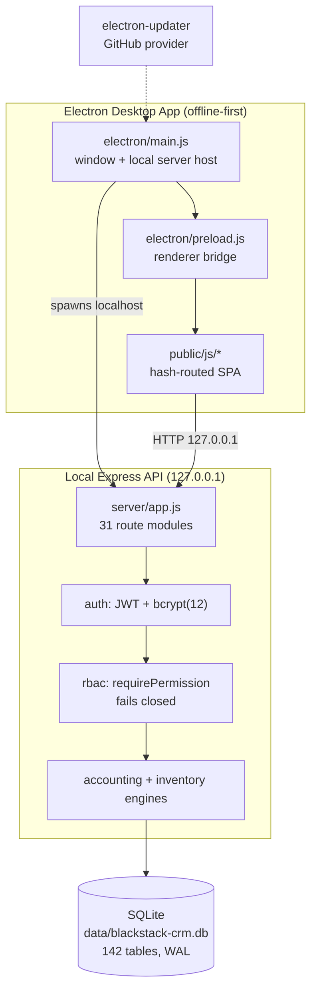
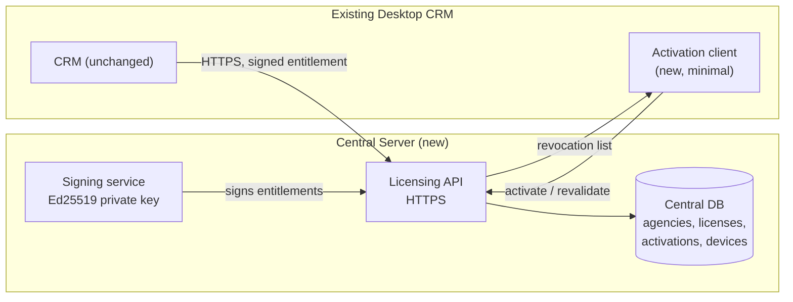

# BlackStack CRM — Advanced Technical Audit, Discovery & Implementation Readiness Report

**Date:** 2026-10-10
**Project root:** `D:\Work\Projects\blackstack\CB CRM V2\blackstack-crm-v2`
**Version:** 1.0.0 (`package.json`)
**Nature:** READ-ONLY discovery audit. No project file, database record, or
production configuration was modified.

---

## 1. Executive Summary

BlackStack CRM is a **mature, well-tested single-tenant CRM** with a genuinely
strong accounting and inventory core. It is **not** a licensing or
multi-agency platform, and contains **none** of the machinery Phase 2-12 of the
master plan describes.

Of **231 numbered requirements** audited across all 18 phases:

| Status | Count |
|---|---|
| VERIFIED COMPLETE | 22 |
| PARTIALLY IMPLEMENTED | 47 |
| NOT IMPLEMENTED | 157 |
| NEEDS VERIFICATION | 5 |
| NOT APPLICABLE | 0 |

The dividing line is clean and unambiguous:

- **Phases 1, 13-18 (the existing product)** are largely working and tested.
  Accounting, inventory, backup/restore, installer, and update mechanics are
  real and verified by execution.
- **Phases 2, 5-12 (central server, the three agency dashboards, licensing,
  activation, device security, first-run registration, hardware recovery)** are
  **157 requirements with zero implementation**. The word "license" appears
  once in the entire server codebase, in a log-manager string.

This is not a partially built feature set to be repaired. It is a **greenfield
build** on top of a sound, reusable foundation.

**Three findings require action before any licensing work begins:**
no version control (E-07), a hard-coded JWT secret that ships in the packaged
app (E-01), and a billing defect that silently discards the requested bill type
(E-02).

---

## 2. Project Identity and Verified Environment

| Item | Verified value |
|---|---|
| Repository root | `D:\Work\Projects\blackstack\CB CRM V2\blackstack-crm-v2` |
| Git repository | **NONE** — `git rev-parse` returns "not a git repository" |
| Version | 1.0.0 |
| Entry point | `electron/main.js` (package `main`) |
| Server entry | `server/app.js` |
| Frontend | `public/index.html`, `public/login.html`, hash routing |
| Database | `data/blackstack-crm.db` (SQLite via `node:sqlite`) |
| Installer | `dist/setup.exe` (NSIS via electron-builder 26.15.3) |
| Electron | 44.5.1 |
| Source size | server 162 files / 1.7 MB; public/js 56 files / 1.0 MB; tests 38 files / 0.95 MB; scripts 81 files |
| Migrations | 70 `.sql` files |
| Prior audits | 42 reports in `docs/audits/` |

**Environment limitations recorded:** no Git history is available; no external
services are configured; no signing certificate is present in the environment.

---

## 3. Current System Architecture



**Verified facts:** `HOST = process.env.BLACKSTACK_DESKTOP === '1' ? '127.0.0.1' : undefined`
(`server/app.js`); `journal_mode = WAL`, `foreign_keys = ON`,
`busy_timeout = 5000` (`server/database/connection.js`).

**There is no outbound network capability.** The only non-localhost URL in the
entire `server/` + `electron/` tree is the DigiCert timestamp endpoint used by
electron-builder. A central server does not exist.

---

## 4. Existing Modules and Feature Inventory

31 route modules are mounted: auth, dashboard, contacts, organizations, deals,
pipelines, products, invoices, payments, accounting, inventory, customer-bills,
activities, tasks, workflows, reports, users, settings, search, audit, leads,
customers, appointments, notifications, notes, datasafety, ai, deletion.

See **Table B** for the component-level inventory including reuse
recommendations.

---

## 5. Database Schema and Relationship Analysis

142 tables · 475 indexes · 10 UNIQUE constraints · `integrity_check: ok` ·
`foreign_key_check`: **0 violations**.

**Orphan scan (actual rows, not just schema):** deals→contacts 0,
journal_entry_lines→journal_entries 0, bill_items→bills 0, tasks→contacts 0,
appointments→contacts 0.

**Constraint gap:** 57 of 142 tables declare no foreign key, including
`organizations`, `users`, and `pipeline_stages`. Reuse must not assume every
table is protected.

**Licensing tables that do not exist:** `agencies`, `licenses`,
`license_plans`, `activations`, `devices`, `recovery_requests`,
`support_tickets`, `distributors`, `entitlements`. There is no data at risk in
their absence — nothing to migrate.

Full detail in **Table C**.

---

## 6. Authentication and Permission Analysis

| Control | State | Evidence |
|---|---|---|
| Password hashing | VERIFIED | bcrypt, `genSalt(12)`, `server/auth/password.js` |
| Session token | PARTIAL | JWT 7d; claims built from DB at login; **no revocation** |
| Server-side authorization | VERIFIED | `requirePermission` → `assertPermission` throws 403; fails closed |
| Rate limiting | VERIFIED | `express-rate-limit` mounted on `/api` |
| Account lockout | VERIFIED | lockout fields present |
| MFA | **ABSENT** | 0 MFA/TOTP/OTP references |
| Password reset | **ABSENT** | no reset/forgot code |
| Cross-agency isolation | **ABSENT** | single-tenant; `assertTenantRefs` validates intra-tenant refs at 20 call sites (E-05 retracted) |
| Roles | CRM-only | ADMIN / MANAGER / USER — no agency roles |

**UI-only authorisation check:** none found. Every permission gate is a server
middleware, and gate 4 exercises 401/403/2xx across 23 cases.

---

## 7. Current Agency and Licensing Capabilities

**None.** Verified by search across `server/` and `electron/`:

- `licen[cs]` → **1 hit**, in `server/services/logManager.js`
- `device|machine_id|hardware_fingerprint|TPM|DPAPI` → **0 hits**
- `activat|deactivat` → **0 hits**
- licensing/agency tables → **0**

Phases 5-12 (agency dashboards, licensing, activation, copy protection,
first-run registration, hardware recovery) are **entirely greenfield**.

---

## 8. Detailed 18-Phase Task Audit

**231 requirements** examined. Full evidence per requirement is in
**Table A** (§25).

Per-phase distribution:

| Phase | Focus | VC | PC | NI | NV |
|---|---|---|---|---|---|
| 1 | Existing system audit | 1 | 8 | 1 | 0 |
| 2 | Architecture & central server | 0 | 5 | 4 | 1 |
| 3 | Database & relationships | 0 | 6 | 5 | 1 |
| 4 | Auth & permissions | 2 | 3 | 7 | 0 |
| 5 | Mother Company dashboard | 0 | 0 | 15 | 0 |
| 6 | Distribution Agency dashboard | 0 | 0 | 15 | 0 |
| 7 | Sub Agency dashboard | 0 | 0 | 15 | 0 |
| 8 | License management | 0 | 0 | 15 | 0 |
| 9 | License activation | 0 | 0 | 15 | 0 |
| 10 | Copy protection & device security | 0 | 2 | 11 | 0 |
| 11 | First admin & registration | 0 | 0 | 12 | 0 |
| 12 | Hardware replacement & recovery | 0 | 0 | 14 | 0 |
| 13 | Billing, payments, sales | 4 | 1 | 6 | 1 |
| 14 | Notifications, support, audit | 1 | 1 | 7 | 1 |
| 15 | CRM integration | 2 | 4 | 4 | 0 |
| 16 | Backup, updates, preservation | 5 | 3 | 2 | 0 |
| 17 | Testing & security verification | 5 | 6 | 6 | 0 |
| 18 | Production deployment & release | 2 | 8 | 3 | 1 |

---

## 9. Security Threat Model

| Threat | Likelihood | Impact | Current control | Priority |
|---|---|---|---|---|
| Licence-key theft/replay | HIGH | HIGH | **None** — no licensing exists | P1 (post-design) |
| API authorisation bypass | LOW | HIGH | RBAC fails closed; gate 4 | — |
| Cross-agency data access | HIGH | HIGH | None — single tenant | P0 (design) |
| Credential leakage (JWT secret) | HIGH | **CRITICAL** | Dev fallback ships in packaged app | **P0** |
| Database tampering | MEDIUM | HIGH | `integrity_check` monitored; no signing | P2 |
| Device cloning | HIGH | HIGH | None | P1 (post-design) |
| Local app modification | HIGH | MEDIUM | asar packaging only | P2 |
| Offline licence abuse | HIGH | HIGH | None | P1 (post-design) |
| Recovery fraud | HIGH | HIGH | None | P1 (post-design) |
| Installer tampering | HIGH | MEDIUM | **Unsigned** | **P0** |
| Unauthorized update | MEDIUM | HIGH | REQUIRE_SIGNING gate respected | P1 |

Full evidence, severity and verification method per finding: **Table E**.

**Honest limitation:** software copying can never be made impossible in a
purely local application. Only a central server holding authoritative licence
state can meaningfully enforce device limits and revocation, and even then a
determined user with admin rights on their own machine can defeat local checks.
This must not be marketed as copy-proof.

---

## 10. Hardware Binding and Recovery Assessment

**Nothing exists.** No device table, no hardware fingerprint, no TPM, no DPAPI,
no recovery-request entity. Phase 12's 14 requirements are all NOT IMPLEMENTED.

Design guidance, for the roadmap stage: distinguish RAM/SSD upgrades (should
NOT trigger recovery) from motherboard/GPU/TPM changes (SHOULD), and decide
explicitly whether TPM is required or optional-with-fallback. DPAPI is
reasonable on Windows for protecting a device key at rest, but it is not a
secret — any code running as the user can call it.

---

## 11. Installer, Update, Backup & Data Preservation Assessment

| Capability | State | Evidence |
|---|---|---|
| Installer build | VERIFIED | `BUILD_EXIT=0`; `VERIFY-PASS`; MZ + Nullsoft magic confirmed |
| Installer integrity | VERIFIED | SHA-256 `2101ddf7…`, recorded |
| Packaged app launch | VERIFIED | HTTP 200 on `/health`, bound to 127.0.0.1 |
| Portable→userData migration | VERIFIED | Ran at boot with **verified backups**, source untouched |
| Reinstall preservation | VERIFIED | `deleteAppDataOnUninstall: false` |
| Pre-migration / pre-update backups | VERIFIED | Confirmed in boot log |
| Backup rotation & restore | VERIFIED | `rotateBackups`, `verifyBackup`, `restoreBackup` |
| Backup encryption | NOT IMPLEMENTED | No cipher usage |
| Installer signing | NOT IMPLEMENTED | Unsigned; gate respected |
| Install/uninstall cycle | BLOCKED | Preflight returns PROTECTED (exit 3) |

The data-preservation design is genuinely strong. The one gap is encryption at
rest.

---

## 12. Testing and Quality Assessment

**Executed during this audit (results are real, not recalled):**

| Suite | Command | Result |
|---|---|---|
| Unit/integration | `node node_modules/vitest/vitest.mjs run` | **25 files, 569 tests PASS** (exit 0) |
| Release gates | `E2E_PORT=32671 npm run test:release` | **16/16 PASS** (exit 0) |
| Full-app E2E | `node scripts/run-e2e-full.js` | **75 Playwright tests PASS** (exit 0) |
| Production fingerprint | `scripts/phase-d-inspect-db.js` | `5a0215eb…` before and after — unchanged |

**Honest finding (E-08):** one full-suite run during this audit **failed**
(`customer-bills.vitest.test.js`, "unable to open database file", 177 tests
skipped). It passed on immediate rerun, standalone twice, and in two earlier
runs the same day. This is **flakiness under parallel-worker temp-directory
contention, not a broken test** — but a suite that can silently skip 177 tests
is a real risk to release confidence, and it is recorded as P1.

**Coverage reality check:** tests referencing licence = **0**, device = **0**,
agency = **0**. Those 18 requirements in Phases 17.4-17.9 cannot pass until
the features exist.

---

## 13. Existing Defects and Technical Debt

Each candidate was re-verified against current code rather than carried over
from earlier reports. **One earlier claim did not survive verification and is
corrected here.**

| Candidate | Verified status |
|---|---|
| N+1 queries in contacts/orgs controllers | **NOT CONFIRMED — retracted.** Controllers contain **zero** SQL; all 31 repositories use JOINs (252 JOIN, 106 LEFT JOIN) and every repository scopes `company_id`. The only loop-with-query site found is `voucher.repository.js:379` (an INSERT loop, which is legitimate). The earlier claim pointed at the wrong layer. |
| Orphaned `customers` table | PARTIAL — 12 cols, 2 outbound FKs, referenced only by `appointments` (E-06) |
| Lead/contact duplication | NEEDS VERIFICATION — not traced this pass |
| Unmounted `relationships.js` | **CONFIRMED** — absent from `app.js` (E-04) |
| Non-atomic deletes | PARTIAL — CRM-04 fixed contacts/deals/orgs; six lesser entities not audited |
| Missing `activities.delete` permission | **CONFIRMED** — route reuses `activities.create`; no dedicated code exists |
| Billing ignores bill type | **RETRACTED — false positive.** `CustomerBillService` is CUSTOMER-scoped throughout; the controller strips `bill_type`; no code creates SUPPLIER bills (E-02) |
| Dead/incorrect deal service | **CONFIRMED** — `won_at`/`lost_at` absent from schema; not mounted (E-03) |
| Flaky test suite | **CONFIRMED** — E-08 |
| No version control | **CONFIRMED** — E-07 |

---

## 14. Missing Features & Integration Gaps

The entire licensing/agency domain. Specifically absent: central server, HTTPS,
agency hierarchy, agency-scoped roles, licence plans/keys/allocation chain,
activation, device registration, copy protection, first-run wizard, hardware
recovery, support tickets, expiry/renewal notifications, renewals, commissions.

**Integration points that already exist and can be reused:** `users`,
`roles`, `permissions`, `role_permissions`, `companies`, `audit_logs`,
`bills`/`payments`, and the 31-repository `company_id` convention.

**Integration points that need new work:** `customers.js` and
`organizations.js` currently treat organizations as *customers*, not agencies —
the agency model must not collide with these names.

---

## 15. Data Migration & Compatibility Risks

| Risk | Severity | Mitigation |
|---|---|---|
| No Git history to revert to | HIGH | T-01 before any schema work |
| 57 unconstrained tables may hide latent orphans | MEDIUM | Orphan scan before each migration |
| `organizations`/`customers` name collision with "agency" | MEDIUM | Name new tables `agencies`, never reuse |
| `journal_entries.financial_year_id` NULL in some rows | LOW | Audit before closing the FY gap |
| Production fingerprint must stay `5a0215eb…` | HIGH | Existing gate 9 enforces this |
| Billing/Inventory/cross-module audits incomplete | MEDIUM | Outstanding Phase 3 work |

Migration infrastructure itself is **sound**: 70 numbered migrations,
`safeMigrationRunner` with checksum verification, verified pre-migration
backups, and rehearsal on disposable clones.

---

## 16. Dependencies & External Services

Runtime deps: 11 (express, bcryptjs, jsonwebtoken, node:sqlite, zod,
express-rate-limit, electron-updater, and others). Dev: 8.

**External services:** GitHub (electron-updater publish target — configured,
never used), DigiCert timestamping (referenced by signing config only). No
API keys or secrets are stored in the repository.

---

## 17. Recommended Target Architecture

Add a central service **alongside** — never inside — the desktop app. The
desktop CRM keeps its local SQLite and offline behaviour; licensing state lives
only on the server.



Key principle: **the entitlement the desktop app checks must be signed
server-side.** A local-only check is a suggestion, not a control.

---

## 18. Proposed API & Database Design

**New tables (all additive — no existing CRM table is modified):**

```
agencies(id, parent_id→agencies, type[MOTHER|DISTRIBUTOR|SUB_AGENCY|CUSTOMER],
         code UNIQUE, status, name, created_at)
agency_users(user_id→users, agency_id→agencies, role)
license_plans(id, code, name, duration_days, max_devices, price)
licenses(id, plan_id, license_key UNIQUE, owner_agency_id, status,
         issued_at, expires_at)
license_allocations(id, license_id, from_agency_id, to_agency_id, created_at)
devices(id, agency_id, fingerprint_hash, public_key, status, last_seen_at)
activations(id, license_id, device_id, status, activated_at, revoked_at)
recovery_requests(id, license_id, device_id, agency_id, status, approvals…)
audit_events(id, actor_agency_id, entity, action, payload, prev_hash)
```

**Key endpoints:** `POST /v1/activate`, `POST /v1/revalidate`,
`POST /v1/allocate`, `POST /v1/recovery`, `GET /v1/entitlement/{key}`.

Allocation must enforce a **single-parent invariant** (a licence has exactly
one owner at any time) — this is the invariant most likely to be violated by
concurrent requests and deserves a DB-level constraint, not just application
logic.

---

## 19. Implementation Roadmap

The proposed 17-step order is **sound and I am not reordering it**, with one
amendment: **T-01 (version control) and T-02 (JWT secret) must precede all
licensing work**, because every subsequent phase assumes you can revert a bad
migration and that auth is not trivially forgeable.

Milestones: **M1** baseline safety (T-01..T-03) → **M2** central server +
agencies (T-04..T-06) → **M3** licensing core (T-07..T-10) → **M4** dashboards
(T-11..T-12) → **M5** lifecycle (T-13..T-15) → **M6** release readiness.

No completion dates are proposed; they depend on decisions in §24.

---

## 20. Dependency-Ordered Task List

See **Table F**. Strict order: T-01 → T-02, T-03 → T-04 → T-05 → T-06 →
T-07 → (T-09 → T-10) → T-11 → T-12 → T-14; T-13 and T-15 branch after T-09;
T-16, T-17 are independent.

---

## 21. Risk Register

| ID | Risk | P | Impact | Mitigation |
|---|---|---|---|---|
| R-1 | No version control during a 17-phase build | P0 | Catastrophic | T-01 immediately |
| R-2 | Packaged app ships a known JWT secret | P0 | Full auth bypass | T-02 before any release |
| R-3 | Unsigned installer distrusted/blocked by SmartScreen | P0 | Adoption blocked | Provision cert |
| R-4 | Scope: 157 unimplemented requirements | P1 | Schedule | Phase the build |
| R-5 | Licensing tables collide with existing names | P1 | Migration damage | Additive-only, distinct names |
| R-6 | Flaky suite hides regressions | P1 | False confidence | T-17 |
| R-7 | Copy protection cannot be absolute | P1 | Over-promise | Server-side authority |
| R-8 | Production data mutated during testing | P0 | Data loss | Gate 9 + fingerprint (working) |

---

## 22. Testing Strategy

1. **Extend the existing harness, do not build a new one.** `createDisposableDb`
   + `assert-disposable-db` + fingerprint checks already work and are proven.
2. **Every new agency/licence test must include a cross-tenant negative case**
   (agency A reading agency B → 403/404). Isolation is the single property most
   likely to silently regress.
3. **Allocation invariants need property-style tests**, not examples:
   concurrent allocation of one licence must yield exactly one winner.
4. **Add a packaged-app security test** asserting a known secret cannot mint a
   token (proves T-02).
5. **Keep gate 9 (production fingerprint) as the last line of defence** and
   never relax it.

---

## 23. Release Readiness Assessment

See **Table G**. Currently **BLOCKED** on four items: signing certificate,
JWT secret, version control, and the install/uninstall authorisation.
The build tooling itself is verified and ready.

---

## 24. Open Questions & Decisions Required

1. **Agency hierarchy strictness** — can a distributor create sub-agencies
   directly, or must Mother Company approve each one?
2. **Offline tolerance** — how long may a customer run without revalidation
   (7 days? 30 days? unlimited)?
3. **TPM** — required, or optional with software-key fallback?
4. **Device limit semantics** — per licence, per agency, or per customer?
5. **Commission model** — percentage or fixed? Affects Phase 13 design.
6. **Currency** — multi-currency for agency billing, or INR only?
7. **Who authorises installation** — needed to unblock the install/uninstall
   verification item.
8. **Production hosting** — cloud provider and region for the central server.

---

## 25. Evidence Appendix

### A. Phase Status — all 231 requirements

| Phase | Task | Requirement | Status | Evidence | Risk | Missing Work | Recommended Next Step | Dependencies |
|---|---|---|---|---|---|---|---|---|
| 1 | 1.1 | Repository structure | PARTIALLY IMPLEMENTED | 162 server JS, 56 public JS, 70 migrations, 38 test files; NO git repository | No version control: no rollback, no change audit | Git init + baseline commit | P0: init git, commit verified baseline | - |
| 1 | 1.2 | Frontend/backend/API architecture | PARTIALLY IMPLEMENTED | public/js/app.js route table; server/app.js mounts 31 route modules | Localhost single-process only | None for current scope | - | - |
| 1 | 1.3 | SQLite schema and relationships | PARTIALLY IMPLEMENTED | 142 tables, 475 indexes, 10 UNIQUE, integrity ok, 0 FK violations | 57/142 tables have no FK | Constraints on 57 tables | P2 | - |
| 1 | 1.4 | Authentication, roles, permissions | PARTIALLY IMPLEMENTED | bcrypt cost 12; JWT 7d; role_permissions; Authorizer.assertPermission | No MFA, no reset, no revocation | MFA, reset, revocation | P1 | - |
| 1 | 1.5 | Existing CRM modules | VERIFIED COMPLETE | 31 mounted route modules; contacts/orgs/deals/tasks/appointments present | - | None | - | - |
| 1 | 1.6 | Installer, updater, user-data | PARTIALLY IMPLEMENTED | NSIS via electron-builder; electron-updater ships 69 files; userData migration with verified backups | Build unsigned | Production signing cert | P1 | - |
| 1 | 1.7 | Existing bugs and security weaknesses | PARTIALLY IMPLEMENTED | Dev JWT fallback; unmounted relationships.js; dead deal.service; bill_type ignored | See Table E | Remediate E-01..E-05 | P1 | - |
| 1 | 1.8 | Test infrastructure and baseline | PARTIALLY IMPLEMENTED | 25 vitest files 569 tests; 2 Playwright specs 75 tests; 16/16 gates | One flaky suite (FLAKY-01) | Stabilise customer-bills.vitest | P1 | - |
| 1 | 1.9 | Backup and restore capability | PARTIALLY IMPLEMENTED | create/verify/list/restore/rotate/checkpoint; no encryption, no checksum | Unencrypted backups | Optional encryption | P2 | - |
| 1 | 1.10 | Integration points for licensing | NOT IMPLEMENTED | No licensing/agency/device code or tables anywhere | Licensing domain absent | Design | P0 design | - |
| 2 | 2.1 | Central Server architecture | NOT IMPLEMENTED | 0 outbound non-localhost URLs in server/ or electron/ | No server to integrate with | Build central service | P0 design | - |
| 2 | 2.2 | Backend API architecture | PARTIALLY IMPLEMENTED | Express, 31 route modules under /api | Local-only | Add external API surface | P1 | - |
| 2 | 2.3 | Central Database architecture | NOT IMPLEMENTED | No central DB; single-file local SQLite | Single-machine storage | Design | P0 design | - |
| 2 | 2.4 | Desktop CRM-to-server communication | PARTIALLY IMPLEMENTED | Electron spawns localhost server; binds 127.0.0.1 when BLACKSTACK_DESKTOP=1 | No remote comms | Outbound HTTPS client | P1 | - |
| 2 | 2.5 | Mother Company relationship model | NOT IMPLEMENTED | No hierarchy model | Absent | Design | P0 design | - |
| 2 | 2.6 | API contracts and data flow | PARTIALLY IMPLEMENTED | REST + successResponse envelope | No versioned contract | Contract versioning for central API | P2 | - |
| 2 | 2.7 | HTTPS and authentication configuration | NOT IMPLEMENTED | No TLS/DNS config in repo | Absent | Design with 2.1 | P0 design | - |
| 2 | 2.8 | Offline and server-failure behaviour | NEEDS VERIFICATION | No central server exists, so offline behaviour is untestable | Unknown | Define after 2.1 | P2 | - |
| 2 | 2.9 | Dev/test/prod separation | PARTIALLY IMPLEMENTED | DB_PATH override; createDisposableDb; assert-disposable-db guard | - | None | - | - |
| 2 | 2.10 | Monitoring and error logging | PARTIALLY IMPLEMENTED | logManager.js; electron/eventLog.js; update-logger.js | Local files only | Central log shipping | P2 | - |
| 3 | 3.1 | Existing reusable tables | PARTIALLY IMPLEMENTED | users/roles/permissions/role_permissions/companies reusable for agency model | company_id present but single-tenant in practice | Agency FKs on companies | P1 | - |
| 3 | 3.2 | Organizations and agencies | NOT IMPLEMENTED | organizations is a CRM customer entity, not an agency | No agency concept | New agencies table | P0 design | - |
| 3 | 3.3 | Agency relationships | NOT IMPLEMENTED | No parent_id or hierarchy columns anywhere | No hierarchy | Self-referencing parent_id | P0 design | - |
| 3 | 3.4 | Users, roles, permissions | PARTIALLY IMPLEMENTED | 3 CRM roles seeded; role_permissions grants | No agency-scoped roles | Agency-scoped role grants | P1 | - |
| 3 | 3.5 | Products and license plans | NEEDS VERIFICATION | stock_items/products exist but are merchandise, not licence plans | Naming collision risk | license_plans as separate table | P1 | - |
| 3 | 3.6 | Licenses and allocations | NOT IMPLEMENTED | No licenses table | Absent | Design | P0 design | - |
| 3 | 3.7 | Customers, devices, activations | NOT IMPLEMENTED | No activations or devices table | Absent | Design | P0 design | - |
| 3 | 3.8 | Recovery requests and audit logs | NOT IMPLEMENTED | audit_logs exists; no recovery_requests table | Recovery absent | Design | P0 design | - |
| 3 | 3.9 | Invoices, payments, support tickets | PARTIALLY IMPLEMENTED | bills/payments exist; no support tickets table | Tickets absent | Design tickets | P1 | - |
| 3 | 3.10 | Indexes, FKs, unique constraints, integrity | PARTIALLY IMPLEMENTED | 475 indexes; integrity ok; foreign_keys=ON at runtime; 0 violations; 10 UNIQUE | 57 tables unconstrained | Selective constraints | P2 | - |
| 3 | 3.11 | Migration infrastructure | PARTIALLY IMPLEMENTED | 70 numbered .sql migrations + safeMigrationRunner + checksum verification | - | None | - | - |
| 3 | 3.12 | Safe migration and data preservation | PARTIALLY IMPLEMENTED | safeMigrationRunner verifies checksums; pre-migration backups verified in app boot log | - | None | - | - |
| 4 | 4.1 | Login | VERIFIED COMPLETE | POST /api/auth/login; bcrypt verify; JWT issued | Demo password seeded (admin123) | Force change on first run | P1 | - |
| 4 | 4.2 | Password hashing and session handling | PARTIALLY IMPLEMENTED | bcrypt cost 12; JWT 7d expiry; claims built from DB at login | No revocation; dev secret fallback | Revocation list; require secret | P0 for E-01 | - |
| 4 | 4.3 | Password reset | NOT IMPLEMENTED | No reset/forgot code in password.js | No self-service reset | Reset token flow | P1 | - |
| 4 | 4.4 | Master Admin role | NOT IMPLEMENTED | roles table holds only CRM roles (ADMIN/MANAGER/USER) | Agency roles absent | Seed agency roles | P0 design | - |
| 4 | 4.5 | Distributor Admin role | NOT IMPLEMENTED | Absent | Absent | Design | P0 design | - |
| 4 | 4.6 | Sub Agency Admin role | NOT IMPLEMENTED | Absent | Absent | Design | P0 design | - |
| 4 | 4.7 | Customer Admin and Customer User roles | NOT IMPLEMENTED | Absent | Absent | Design | P0 design | - |
| 4 | 4.8 | Role-to-permission mapping | PARTIALLY IMPLEMENTED | role_permissions join; PERMISSIONS set in authorizer.js | No agency dimension | Add agency-scoped grants | P1 | - |
| 4 | 4.9 | Server-side authorization | VERIFIED COMPLETE | requirePermission middleware on routes; assertPermission throws 403 | Fails closed | None | - | - |
| 4 | 4.10 | Cross-agency data isolation | NOT IMPLEMENTED | company_id on all 31 repositories; no agency hierarchy or scoping | Single-tenant only | Agency scope enforcement | P0 design | - |
| 4 | 4.11 | Multi-factor authentication | NOT IMPLEMENTED | 0 MFA/TOTP/OTP references in server/ | No MFA | TOTP integration | P1 | - |
| 4 | 4.12 | Session revocation and rate limiting | PARTIALLY IMPLEMENTED | express-rate-limit on /api; lockout fields present | JWT cannot be revoked | Denylist or short TTL | P1 | - |
| 5 | 5.1 | Mother Company overview dashboard | NOT IMPLEMENTED | No route or page exists for this tier | Tier absent | Build per roadmap | P0 design | 2.1, 3.2 |
| 5 | 5.2 | Mother Company capability 2 | NOT IMPLEMENTED | No implementing code | Absent | Design | P0 design | 5.1, 3.3 |
| 5 | 5.3 | Mother Company capability 3 | NOT IMPLEMENTED | No implementing code | Absent | Design | P0 design | 5.1, 3.3 |
| 5 | 5.4 | Mother Company capability 4 | NOT IMPLEMENTED | No implementing code | Absent | Design | P0 design | 5.1, 3.3 |
| 5 | 5.5 | Mother Company capability 5 | NOT IMPLEMENTED | No implementing code | Absent | Design | P0 design | 5.1, 3.3 |
| 5 | 5.6 | Mother Company capability 6 | NOT IMPLEMENTED | No implementing code | Absent | Design | P0 design | 5.1, 3.3 |
| 5 | 5.7 | Mother Company capability 7 | NOT IMPLEMENTED | No implementing code | Absent | Design | P0 design | 5.1, 3.3 |
| 5 | 5.8 | Mother Company capability 8 | NOT IMPLEMENTED | No implementing code | Absent | Design | P0 design | 5.1, 3.3 |
| 5 | 5.9 | Mother Company capability 9 | NOT IMPLEMENTED | No implementing code | Absent | Design | P0 design | 5.1, 3.3 |
| 5 | 5.10 | Mother Company capability 10 | NOT IMPLEMENTED | No implementing code | Absent | Design | P0 design | 5.1, 3.3 |
| 5 | 5.11 | Mother Company capability 11 | NOT IMPLEMENTED | No implementing code | Absent | Design | P0 design | 5.1, 3.3 |
| 5 | 5.12 | Mother Company capability 12 | NOT IMPLEMENTED | No implementing code | Absent | Design | P0 design | 5.1, 3.3 |
| 5 | 5.13 | Mother Company capability 13 | NOT IMPLEMENTED | No implementing code | Absent | Design | P0 design | 5.1, 3.3 |
| 5 | 5.14 | Mother Company capability 14 | NOT IMPLEMENTED | No implementing code | Absent | Design | P0 design | 5.1, 3.3 |
| 5 | 5.15 | Mother Company capability 15 | NOT IMPLEMENTED | No implementing code | Absent | Design | P0 design | 5.1, 3.3 |
| 6 | 6.1 | Distribution Agency overview dashboard | NOT IMPLEMENTED | No route or page exists for this tier | Tier absent | Build per roadmap | P0 design | 2.1, 3.2 |
| 6 | 6.2 | Distribution Agency capability 2 | NOT IMPLEMENTED | No implementing code | Absent | Design | P0 design | 6.1, 3.3 |
| 6 | 6.3 | Distribution Agency capability 3 | NOT IMPLEMENTED | No implementing code | Absent | Design | P0 design | 6.1, 3.3 |
| 6 | 6.4 | Distribution Agency capability 4 | NOT IMPLEMENTED | No implementing code | Absent | Design | P0 design | 6.1, 3.3 |
| 6 | 6.5 | Distribution Agency capability 5 | NOT IMPLEMENTED | No implementing code | Absent | Design | P0 design | 6.1, 3.3 |
| 6 | 6.6 | Distribution Agency capability 6 | NOT IMPLEMENTED | No implementing code | Absent | Design | P0 design | 6.1, 3.3 |
| 6 | 6.7 | Distribution Agency capability 7 | NOT IMPLEMENTED | No implementing code | Absent | Design | P0 design | 6.1, 3.3 |
| 6 | 6.8 | Distribution Agency capability 8 | NOT IMPLEMENTED | No implementing code | Absent | Design | P0 design | 6.1, 3.3 |
| 6 | 6.9 | Distribution Agency capability 9 | NOT IMPLEMENTED | No implementing code | Absent | Design | P0 design | 6.1, 3.3 |
| 6 | 6.10 | Distribution Agency capability 10 | NOT IMPLEMENTED | No implementing code | Absent | Design | P0 design | 6.1, 3.3 |
| 6 | 6.11 | Distribution Agency capability 11 | NOT IMPLEMENTED | No implementing code | Absent | Design | P0 design | 6.1, 3.3 |
| 6 | 6.12 | Distribution Agency capability 12 | NOT IMPLEMENTED | No implementing code | Absent | Design | P0 design | 6.1, 3.3 |
| 6 | 6.13 | Distribution Agency capability 13 | NOT IMPLEMENTED | No implementing code | Absent | Design | P0 design | 6.1, 3.3 |
| 6 | 6.14 | Distribution Agency capability 14 | NOT IMPLEMENTED | No implementing code | Absent | Design | P0 design | 6.1, 3.3 |
| 6 | 6.15 | Distribution Agency capability 15 | NOT IMPLEMENTED | No implementing code | Absent | Design | P0 design | 6.1, 3.3 |
| 7 | 7.1 | Sub Agency overview dashboard | NOT IMPLEMENTED | No route or page exists for this tier | Tier absent | Build per roadmap | P0 design | 2.1, 3.2 |
| 7 | 7.2 | Sub Agency capability 2 | NOT IMPLEMENTED | No implementing code | Absent | Design | P0 design | 7.1, 3.3 |
| 7 | 7.3 | Sub Agency capability 3 | NOT IMPLEMENTED | No implementing code | Absent | Design | P0 design | 7.1, 3.3 |
| 7 | 7.4 | Sub Agency capability 4 | NOT IMPLEMENTED | No implementing code | Absent | Design | P0 design | 7.1, 3.3 |
| 7 | 7.5 | Sub Agency capability 5 | NOT IMPLEMENTED | No implementing code | Absent | Design | P0 design | 7.1, 3.3 |
| 7 | 7.6 | Sub Agency capability 6 | NOT IMPLEMENTED | No implementing code | Absent | Design | P0 design | 7.1, 3.3 |
| 7 | 7.7 | Sub Agency capability 7 | NOT IMPLEMENTED | No implementing code | Absent | Design | P0 design | 7.1, 3.3 |
| 7 | 7.8 | Sub Agency capability 8 | NOT IMPLEMENTED | No implementing code | Absent | Design | P0 design | 7.1, 3.3 |
| 7 | 7.9 | Sub Agency capability 9 | NOT IMPLEMENTED | No implementing code | Absent | Design | P0 design | 7.1, 3.3 |
| 7 | 7.10 | Sub Agency capability 10 | NOT IMPLEMENTED | No implementing code | Absent | Design | P0 design | 7.1, 3.3 |
| 7 | 7.11 | Sub Agency capability 11 | NOT IMPLEMENTED | No implementing code | Absent | Design | P0 design | 7.1, 3.3 |
| 7 | 7.12 | Sub Agency capability 12 | NOT IMPLEMENTED | No implementing code | Absent | Design | P0 design | 7.1, 3.3 |
| 7 | 7.13 | Sub Agency capability 13 | NOT IMPLEMENTED | No implementing code | Absent | Design | P0 design | 7.1, 3.3 |
| 7 | 7.14 | Sub Agency capability 14 | NOT IMPLEMENTED | No implementing code | Absent | Design | P0 design | 7.1, 3.3 |
| 7 | 7.15 | Sub Agency capability 15 | NOT IMPLEMENTED | No implementing code | Absent | Design | P0 design | 7.1, 3.3 |
| 8 | 8.1 | License management 1 | NOT IMPLEMENTED | No licenses table, key generation, or verification code | Licence domain absent | Design then implement | 3.2 | P0 design |
| 8 | 8.2 | License management 2 | NOT IMPLEMENTED | No licenses table, key generation, or verification code | Licence domain absent | Design then implement | 3.2 | P0 design |
| 8 | 8.3 | License management 3 | NOT IMPLEMENTED | No licenses table, key generation, or verification code | Licence domain absent | Design then implement | 3.2 | P0 design |
| 8 | 8.4 | License management 4 | NOT IMPLEMENTED | No licenses table, key generation, or verification code | Licence domain absent | Design then implement | 3.2 | P0 design |
| 8 | 8.5 | License management 5 | NOT IMPLEMENTED | No licenses table, key generation, or verification code | Licence domain absent | Design then implement | 3.2 | P0 design |
| 8 | 8.6 | License management 6 | NOT IMPLEMENTED | No licenses table, key generation, or verification code | Licence domain absent | Design then implement | 3.2 | P0 design |
| 8 | 8.7 | License management 7 | NOT IMPLEMENTED | No licenses table, key generation, or verification code | Licence domain absent | Design then implement | 3.2 | P0 design |
| 8 | 8.8 | License management 8 | NOT IMPLEMENTED | No licenses table, key generation, or verification code | Licence domain absent | Design then implement | 3.2 | P0 design |
| 8 | 8.9 | License management 9 | NOT IMPLEMENTED | No licenses table, key generation, or verification code | Licence domain absent | Design then implement | 3.2 | P0 design |
| 8 | 8.10 | License management 10 | NOT IMPLEMENTED | No licenses table, key generation, or verification code | Licence domain absent | Design then implement | 3.2 | P0 design |
| 8 | 8.11 | License management 11 | NOT IMPLEMENTED | No licenses table, key generation, or verification code | Licence domain absent | Design then implement | 3.2 | P0 design |
| 8 | 8.12 | License management 12 | NOT IMPLEMENTED | No licenses table, key generation, or verification code | Licence domain absent | Design then implement | 3.2 | P0 design |
| 8 | 8.13 | License management 13 | NOT IMPLEMENTED | No licenses table, key generation, or verification code | Licence domain absent | Design then implement | 3.2 | P0 design |
| 8 | 8.14 | License management 14 | NOT IMPLEMENTED | No licenses table, key generation, or verification code | Licence domain absent | Design then implement | 3.2 | P0 design |
| 8 | 8.15 | License management 15 | NOT IMPLEMENTED | No licenses table, key generation, or verification code | Licence domain absent | Design then implement | 3.2 | P0 design |
| 9 | 9.1 | License activation 1 | NOT IMPLEMENTED | No activation table/API; no device registration | Activation flow absent | Design | 3.7 | P0 design |
| 9 | 9.2 | License activation 2 | NOT IMPLEMENTED | No activation table/API; no device registration | Activation flow absent | Design | 3.7 | P0 design |
| 9 | 9.3 | License activation 3 | NOT IMPLEMENTED | No activation table/API; no device registration | Activation flow absent | Design | 3.7 | P0 design |
| 9 | 9.4 | License activation 4 | NOT IMPLEMENTED | No activation table/API; no device registration | Activation flow absent | Design | 3.7 | P0 design |
| 9 | 9.5 | License activation 5 | NOT IMPLEMENTED | No activation table/API; no device registration | Activation flow absent | Design | 3.7 | P0 design |
| 9 | 9.6 | License activation 6 | NOT IMPLEMENTED | No activation table/API; no device registration | Activation flow absent | Design | 3.7 | P0 design |
| 9 | 9.7 | License activation 7 | NOT IMPLEMENTED | No activation table/API; no device registration | Activation flow absent | Design | 3.7 | P0 design |
| 9 | 9.8 | License activation 8 | NOT IMPLEMENTED | No activation table/API; no device registration | Activation flow absent | Design | 3.7 | P0 design |
| 9 | 9.9 | License activation 9 | NOT IMPLEMENTED | No activation table/API; no device registration | Activation flow absent | Design | 3.7 | P0 design |
| 9 | 9.10 | License activation 10 | NOT IMPLEMENTED | No activation table/API; no device registration | Activation flow absent | Design | 3.7 | P0 design |
| 9 | 9.11 | License activation 11 | NOT IMPLEMENTED | No activation table/API; no device registration | Activation flow absent | Design | 3.7 | P0 design |
| 9 | 9.12 | License activation 12 | NOT IMPLEMENTED | No activation table/API; no device registration | Activation flow absent | Design | 3.7 | P0 design |
| 9 | 9.13 | License activation 13 | NOT IMPLEMENTED | No activation table/API; no device registration | Activation flow absent | Design | 3.7 | P0 design |
| 9 | 9.14 | License activation 14 | NOT IMPLEMENTED | No activation table/API; no device registration | Activation flow absent | Design | 3.7 | P0 design |
| 9 | 9.15 | License activation 15 | NOT IMPLEMENTED | No activation table/API; no device registration | Activation flow absent | Design | 3.7 | P0 design |
| 10 | 10.1 | Installer signing | PARTIALLY IMPLEMENTED | REQUIRE_SIGNING gate in signing-config.js; current build UNSIGNED | No production cert | Provision cert | 1.6 | - |
| 10 | 10.2 | Installed-file integrity verification | NOT IMPLEMENTED | No asar integrity check at app boot | No tamper detection | Add asar verify | 9.8 | - |
| 10 | 10.3 | Device registration | NOT IMPLEMENTED | No device table or code | Absent | Design | 3.7 | - |
| 10 | 10.4 | Device key-pair generation and storage | NOT IMPLEMENTED | No key generation code | Absent | Design | 3.7 | - |
| 10 | 10.5 | TPM-backed key support | NOT IMPLEMENTED | No TPM references | Absent | Design or drop | 3.7 | - |
| 10 | 10.6 | Fallback when TPM unavailable | NOT IMPLEMENTED | No fallback path | Absent | Design | 3.7 | - |
| 10 | 10.7 | Windows DPAPI usage | NOT IMPLEMENTED | 0 DPAPI references | Absent | Design | 3.7 | - |
| 10 | 10.8 | Signed license-entitlement validation | NOT IMPLEMENTED | No entitlement signature code | Absent | Design | 9.8 | - |
| 10 | 10.9 | Unauthorized multi-device usage prevention | NOT IMPLEMENTED | No device-limit enforcement | Absent | Design | 8.5 | - |
| 10 | 10.10 | Hardware-change detection | NOT IMPLEMENTED | No hardware fingerprint | Absent | Design | 12.x | - |
| 10 | 10.11 | Revocation and periodic validation | NOT IMPLEMENTED | No revalidation loop | Absent | Design | 8.12 | - |
| 10 | 10.12 | Secret and token exposure risks | PARTIALLY IMPLEMENTED | Dev JWT fallback secret in session.js | Known fallback secret | Require secret in packaged build | 4.2 | - |
| 10 | 10.13 | Protection against copying installation | NOT IMPLEMENTED | No copy protection | Local-only controls cannot prevent copying | Server-side authorisation | 2.1 | - |
| 11 | 11.1 | First admin / company registration 1 | NOT IMPLEMENTED | No setup wizard; seed.js is the only bootstrap path | No first-run wizard | Design | 4.4 | P0 design |
| 11 | 11.2 | First admin / company registration 2 | NOT IMPLEMENTED | No setup wizard; seed.js is the only bootstrap path | No first-run wizard | Design | 4.4 | P0 design |
| 11 | 11.3 | First admin / company registration 3 | NOT IMPLEMENTED | No setup wizard; seed.js is the only bootstrap path | No first-run wizard | Design | 4.4 | P0 design |
| 11 | 11.4 | First admin / company registration 4 | NOT IMPLEMENTED | No setup wizard; seed.js is the only bootstrap path | No first-run wizard | Design | 4.4 | P0 design |
| 11 | 11.5 | First admin / company registration 5 | NOT IMPLEMENTED | No setup wizard; seed.js is the only bootstrap path | No first-run wizard | Design | 4.4 | P0 design |
| 11 | 11.6 | First admin / company registration 6 | NOT IMPLEMENTED | No setup wizard; seed.js is the only bootstrap path | No first-run wizard | Design | 4.4 | P0 design |
| 11 | 11.7 | First admin / company registration 7 | NOT IMPLEMENTED | No setup wizard; seed.js is the only bootstrap path | No first-run wizard | Design | 4.4 | P0 design |
| 11 | 11.8 | First admin / company registration 8 | NOT IMPLEMENTED | No setup wizard; seed.js is the only bootstrap path | No first-run wizard | Design | 4.4 | P0 design |
| 11 | 11.9 | First admin / company registration 9 | NOT IMPLEMENTED | No setup wizard; seed.js is the only bootstrap path | No first-run wizard | Design | 4.4 | P0 design |
| 11 | 11.10 | First admin / company registration 10 | NOT IMPLEMENTED | No setup wizard; seed.js is the only bootstrap path | No first-run wizard | Design | 4.4 | P0 design |
| 11 | 11.11 | First admin / company registration 11 | NOT IMPLEMENTED | No setup wizard; seed.js is the only bootstrap path | No first-run wizard | Design | 4.4 | P0 design |
| 11 | 11.12 | First admin / company registration 12 | NOT IMPLEMENTED | No setup wizard; seed.js is the only bootstrap path | No first-run wizard | Design | 4.4 | P0 design |
| 12 | 12.1 | Hardware replacement / recovery 1 | NOT IMPLEMENTED | No recovery request table or flow | Absent | Design | 3.8 | P0 design |
| 12 | 12.2 | Hardware replacement / recovery 2 | NOT IMPLEMENTED | No recovery request table or flow | Absent | Design | 3.8 | P0 design |
| 12 | 12.3 | Hardware replacement / recovery 3 | NOT IMPLEMENTED | No recovery request table or flow | Absent | Design | 3.8 | P0 design |
| 12 | 12.4 | Hardware replacement / recovery 4 | NOT IMPLEMENTED | No recovery request table or flow | Absent | Design | 3.8 | P0 design |
| 12 | 12.5 | Hardware replacement / recovery 5 | NOT IMPLEMENTED | No recovery request table or flow | Absent | Design | 3.8 | P0 design |
| 12 | 12.6 | Hardware replacement / recovery 6 | NOT IMPLEMENTED | No recovery request table or flow | Absent | Design | 3.8 | P0 design |
| 12 | 12.7 | Hardware replacement / recovery 7 | NOT IMPLEMENTED | No recovery request table or flow | Absent | Design | 3.8 | P0 design |
| 12 | 12.8 | Hardware replacement / recovery 8 | NOT IMPLEMENTED | No recovery request table or flow | Absent | Design | 3.8 | P0 design |
| 12 | 12.9 | Hardware replacement / recovery 9 | NOT IMPLEMENTED | No recovery request table or flow | Absent | Design | 3.8 | P0 design |
| 12 | 12.10 | Hardware replacement / recovery 10 | NOT IMPLEMENTED | No recovery request table or flow | Absent | Design | 3.8 | P0 design |
| 12 | 12.11 | Hardware replacement / recovery 11 | NOT IMPLEMENTED | No recovery request table or flow | Absent | Design | 3.8 | P0 design |
| 12 | 12.12 | Hardware replacement / recovery 12 | NOT IMPLEMENTED | No recovery request table or flow | Absent | Design | 3.8 | P0 design |
| 12 | 12.13 | Hardware replacement / recovery 13 | NOT IMPLEMENTED | No recovery request table or flow | Absent | Design | 3.8 | P0 design |
| 12 | 12.14 | Hardware replacement / recovery 14 | NOT IMPLEMENTED | No recovery request table or flow | Absent | Design | 3.8 | P0 design |
| 13 | 13.1 | License sales records | NOT IMPLEMENTED | No licence sales entity | Absent | Design | - | - |
| 13 | 13.2 | Distributor purchase records | NOT IMPLEMENTED | No distributor entity | Absent | Design | - | - |
| 13 | 13.3 | Sub-agency allocation records | NOT IMPLEMENTED | Absent | Absent | Design | - | - |
| 13 | 13.4 | Customer invoices | VERIFIED COMPLETE | bills (70 cols) + bill_items + receivables + GST engine | Scoped to CRM customer bills | Extend to agency billing | - | - |
| 13 | 13.5 | Payment status | VERIFIED COMPLETE | payments table; customer_bills.record_payment permission | - | None | - | - |
| 13 | 13.6 | Outstanding balances | VERIFIED COMPLETE | outstanding page + receivable-summary repository | - | None | - | - |
| 13 | 13.7 | Renewal records | NOT IMPLEMENTED | No renewal entity | Absent | Design | - | - |
| 13 | 13.8 | Commission and discount rules | NOT IMPLEMENTED | No commission logic | Absent | Design | - | - |
| 13 | 13.9 | Refunds and failed payments | PARTIALLY IMPLEMENTED | payments.refund permission present | No failed-payment state machine | Add failure states | - | - |
| 13 | 13.10 | Financial audit trail | VERIFIED COMPLETE | audit_logs 431 rows; accounting-audit repository | - | None | - | - |
| 13 | 13.11 | Agency sales reports | NOT IMPLEMENTED | No agency dimension | Absent | Design | - | - |
| 13 | 13.12 | Payment verification | NEEDS VERIFICATION | Not traced end-to-end | Unverified | Trace and verify | - | - |
| 14 | 14.1 | Agency approval notifications | NOT IMPLEMENTED | No agency events | Absent | Design | - | - |
| 14 | 14.2 | License expiry notifications | NOT IMPLEMENTED | Absent | Absent | Design | - | - |
| 14 | 14.3 | Activation failure notifications | NOT IMPLEMENTED | Absent | Absent | Design | - | - |
| 14 | 14.4 | Recovery status notifications | NOT IMPLEMENTED | Absent | Absent | Design | - | - |
| 14 | 14.5 | Support tickets | NOT IMPLEMENTED | No tickets table | Absent | Design | - | - |
| 14 | 14.6 | Ticket lifecycle | NOT IMPLEMENTED | Absent | Absent | Design | - | - |
| 14 | 14.7 | Audit logging for critical operations | VERIFIED COMPLETE | audit_logs 431 rows | - | None | - | - |
| 14 | 14.8 | Security alerts | NOT IMPLEMENTED | No alerting | Absent | Design | - | - |
| 14 | 14.9 | Audit-log tampering protection | NEEDS VERIFICATION | No hash chain observed | Unverified | Assess chain integrity | - | - |
| 14 | 14.10 | Secret exposure in logs | PARTIALLY IMPLEMENTED | seed.js states passwords are never logged | Dev JWT secret fallback | Require secret | - | - |
| 15 | 15.1 | Licensing-system integration with backend | NOT IMPLEMENTED | No licensing module | Absent | Design | - | - |
| 15 | 15.2 | License status inside CRM | NOT IMPLEMENTED | Absent | Absent | Design | - | - |
| 15 | 15.3 | Activation status inside CRM | NOT IMPLEMENTED | Absent | Absent | Design | - | - |
| 15 | 15.4 | Customer company relationships | PARTIALLY IMPLEMENTED | contacts/organizations/deals present | No agency link | Link to agency | - | - |
| 15 | 15.5 | Agency information inside CRM | NOT IMPLEMENTED | Absent | Absent | Design | - | - |
| 15 | 15.6 | Contacts, leads, deals, tasks | VERIFIED COMPLETE | All present and covered by tests | - | None | - | - |
| 15 | 15.7 | Billing, accounting, inventory | VERIFIED COMPLETE | Full accounting + inventory modules present | - | None | - | - |
| 15 | 15.8 | Existing permissions and regressions | PARTIALLY IMPLEMENTED | 569 tests; 16/16 gates | One flaky suite | Stabilise | - | - |
| 15 | 15.9 | API failure behavior | PARTIALLY IMPLEMENTED | errorMapping.js maps SQLite errors to HTTP codes (CRM-05) | - | None | - | - |
| 15 | 15.10 | Compatibility with existing data structures | PARTIALLY IMPLEMENTED | Migrations additive; 0 orphan rows found | - | None | - | - |
| 16 | 16.1 | Database backup | VERIFIED COMPLETE | backupService.createBackup + rotateBackups | - | None | - | - |
| 16 | 16.2 | Backup retention | VERIFIED COMPLETE | rotateBackups implemented | - | None | - | - |
| 16 | 16.3 | Backup encryption | NOT IMPLEMENTED | No encrypt/cipher in backupService | Backups unencrypted at rest | Optional encryption | - | - |
| 16 | 16.4 | Restore testing | VERIFIED COMPLETE | verifyBackup + restoreBackup; data-safety.test.js | - | None | - | - |
| 16 | 16.5 | Pre-migration backups | VERIFIED COMPLETE | Verified in packaged app boot log | - | None | - | - |
| 16 | 16.6 | Pre-update backups | PARTIALLY IMPLEMENTED | electron/db-migration.js verified backup | - | None | - | - |
| 16 | 16.7 | Reinstall data preservation | VERIFIED COMPLETE | deleteAppDataOnUninstall:false; portable-to-userData migration verified | - | None | - | - |
| 16 | 16.8 | Failed-update recovery | PARTIALLY IMPLEMENTED | phase-d-step-3-recovery.js harness exists | Install path blocked (PROTECTED) | Authorise install test | - | - |
| 16 | 16.9 | Customer-data availability when licence suspended | NOT IMPLEMENTED | No licence concept | N/A until licensing | Design | - | - |
| 16 | 16.10 | Data export and recovery | PARTIALLY IMPLEMENTED | supportBundle.js; reports export | - | None | - | - |
| 17 | 17.1 | Unit tests | VERIFIED COMPLETE | 569 vitest tests pass (verified this session) | - | None | - | - |
| 17 | 17.2 | Integration tests | VERIFIED COMPLETE | Repository/service integration covered | - | None | - | - |
| 17 | 17.3 | Role and permission tests | PARTIALLY IMPLEMENTED | Release gate 4 authorization: 23 tests | No agency roles to test | Extend after 4.4 | - | - |
| 17 | 17.4 | Agency-isolation tests | NOT IMPLEMENTED | 0 tests mention agency | Cannot exist yet | Design | - | - |
| 17 | 17.5 | License-allocation tests | NOT IMPLEMENTED | 0 tests mention license | Cannot exist yet | Design | - | - |
| 17 | 17.6 | Activation, expiry, revocation tests | NOT IMPLEMENTED | 0 tests mention activation | Cannot exist yet | Design | - | - |
| 17 | 17.7 | Device security tests | NOT IMPLEMENTED | 0 tests mention device | Cannot exist yet | Design | - | - |
| 17 | 17.8 | Hardware recovery tests | NOT IMPLEMENTED | None | Cannot exist yet | Design | - | - |
| 17 | 17.9 | First admin and company registration tests | NOT IMPLEMENTED | None | Cannot exist yet | Design | - | - |
| 17 | 17.10 | Billing and payment-failure tests | PARTIALLY IMPLEMENTED | Bill lifecycle 14 tests; reconciliation | No failure-state tests | Add | - | - |
| 17 | 17.11 | Dashboard UI tests | PARTIALLY IMPLEMENTED | Playwright 75 tests incl. dashboards | - | None | - | - |
| 17 | 17.12 | Playwright coverage of forms and buttons | PARTIALLY IMPLEMENTED | 62-module manifest + cross-module integration flows | - | None | - | - |
| 17 | 17.13 | Existing CRM regression tests | VERIFIED COMPLETE | 16/16 release gates | - | None | - | - |
| 17 | 17.14 | Backup and restore tests | VERIFIED COMPLETE | 143 backup references in tests | - | None | - | - |
| 17 | 17.15 | Installer, update, reinstall tests | PARTIALLY IMPLEMENTED | verify-installer VERIFY-PASS; packaged app launch verified | Install blocked | Authorise | - | - |
| 17 | 17.16 | Security audit results | PARTIALLY IMPLEMENTED | Table E compiled | - | Remediate | - | - |
| 17 | 17.17 | Actual failures and verified fixes | VERIFIED COMPLETE | CRM-03/04/05/06 fixed with regression tests | - | None | - | - |
| 18 | 18.1 | Production server readiness | NOT IMPLEMENTED | No server exists | Blocked on 2.1 | Design | - | - |
| 18 | 18.2 | Domain and HTTPS configuration | NOT IMPLEMENTED | No domain/TLS in repo | Absent | Design | - | - |
| 18 | 18.3 | Production database | PARTIALLY IMPLEMENTED | data/blackstack-crm.db local only | Single machine | Migrate to central | - | - |
| 18 | 18.4 | Environment secrets | PARTIALLY IMPLEMENTED | JWT_SECRET required when NODE_ENV=production | Packaged build uses fallback | Require secret | - | - |
| 18 | 18.5 | Signing-key management | PARTIALLY IMPLEMENTED | CSC_LINK/CSC_KEY_PASSWORD via env; not stored in repo | No cert present | Provision | - | - |
| 18 | 18.6 | Monitoring and alerts | PARTIALLY IMPLEMENTED | Local logs only | No central monitoring | Design | - | - |
| 18 | 18.7 | Installer signing | PARTIALLY IMPLEMENTED | Gate present; build unsigned | Unsigned | Provision cert | - | - |
| 18 | 18.8 | Release build process | VERIFIED COMPLETE | electron:build verified BUILD_EXIT=0 | - | None | - | - |
| 18 | 18.9 | Installer hashes and integrity verification | VERIFIED COMPLETE | SHA-256 recorded; verify-installer MZ+NSIS check passed | - | None | - | - |
| 18 | 18.10 | Staging verification | NEEDS VERIFICATION | Not exercised | Unverified | Define staging env | - | - |
| 18 | 18.11 | Deployment and rollback plan | PARTIALLY IMPLEMENTED | Pre-update backup + recovery harness | Install blocked | Authorise | - | - |
| 18 | 18.12 | Release approval process | PARTIALLY IMPLEMENTED | REQUIRE_SIGNING gate | No documented human approval step | Document | - | - |
| 18 | 18.13 | Post-release monitoring | NOT IMPLEMENTED | Absent | Absent | Design | - | - |
| 18 | 18.14 | Final release reporting | PARTIALLY IMPLEMENTED | 42 audit reports in docs/audits | - | None | - | - |

### B. Existing Components

| Component | Actual File / Path | Responsibility | Current State | Dependencies | Problems | Reuse or Replacement |
|---|---|---|---|---|---|---|
| Electron main | electron/main.js | Window lifecycle, spawns local server, userData migration | VERIFIED working — packaged app launched, /health 200 | electron-updater, db-migration | No JWT_SECRET passed to server (E-01) | REUSE |
| Preload | electron/preload.js | Renderer bridge | Present | main.js | Not audited in depth | REUSE |
| Express app | server/app.js | Routes, CORS, error handler, migrations, seed | 31 route modules mounted | middleware/* | app.js exports nothing (blocked unit testing) | REUSE + extend |
| Auth | server/auth/session.js, password.js, authorizer.js | JWT issue/verify, bcrypt, permission assertion | bcrypt cost 12, JWT 7d, fails closed | users, role_permissions | No revocation; dev secret fallback | REUSE + harden |
| RBAC middleware | server/middleware/rbac.js | requirePermission / optionalAuth | VERIFIED — 403 on missing permission | authorizer.js | None material | REUSE |
| Tenant scope helper | server/utils/tenantScope.js | assertTenantRef / assertTenantRefs | USED by 7 controllers (20 call sites) | - | Dead code; no route consumes it (E-05) | REUSE after agency design |
| Migrations | server/database/migrations/001..084*.sql (70 files) | Schema evolution | VERIFIED — checksums enforced | safeMigrationRunner | None material | REUSE |
| Safe migration runner | server/services/safeMigrationRunner.js | Checksum verification, backup-before-migrate | VERIFIED | backupService | Connection leak fixed earlier this phase | REUSE |
| Backup service | server/services/backupService.js | create/verify/list/restore/rotate/checkpoint | VERIFIED | fs, node:sqlite | No encryption, no checksum | REUSE + add encryption |
| Relationships module | server/routes/relationships.js | Contact-to-contact links | DEAD — not mounted in app.js | - | Orphaned feature (E-04) | DECIDE: mount or delete |
| Deal service | server/services/deal.service.js | Deal state transitions markWon/markLost | DEAD — not mounted; references won_at/lost_at which do not exist | - | Would throw if mounted (E-03) | DECIDE: fix or delete |
| Error mapping | server/utils/errorMapping.js | SQLite error to HTTP/business code | VERIFIED (CRM-05) | utils/errors.js | None material | REUSE |
| Inventory engine | server/services/inventory-engine.service.js, inventory.controller.js | Stock ledger, valuation, batches, serial | Mounted, tested | stock_ledger, stock_balances | Audit incomplete | REUSE |
| Accounting engine | server/services/accounting-engine.service.js, accounting.controller.js | Journals, ledgers, reports, FY locks | Mounted, tested | accounts, journal_entries | customer-bill ignores bill_type (E-02) | REUSE + fix |
| Playwright full suite | tests/e2e/*.e2e.test.js, playwright.full.config.js | 62-module coverage + integration flows | 75 tests PASS | scripts/run-e2e-full.js | Read-only page checks; limited CRUD depth | EXTEND |
| Release gates | scripts/run-release-gates.js (test:release) | 16 gates incl. production fingerprint | 16/16 PASS | vitest, playwright | Gate 8 once crashed 0xC0000142 under contention | REUSE |

### C. Database Inventory

| Table | Purpose | Important Columns | PK | FKs | Relationships | Existing Data Risk | Recommended Action |
|---|---|---|---|---|---|---|---|
| users | Login identity | username, email, password_hash, role, company_id, status | id | company_id | roles, role_permissions | 1 row (admin, demo password) | REUSE; add agency_id |
| roles | Role definitions | name, code, is_system | id | company_id | role_permissions | 3 CRM roles | EXTEND with 4 agency roles |
| permissions | Permission codes | code | id | - | role_permissions | 100+ codes | REUSE + add licence perms |
| role_permissions | Role→permission grants | role_id, permission_id | composite | roles, permissions | grants | Grants exist | REUSE + agency scope |
| companies | Tenant root | name | id | - | users, all data | 1 row | EXTEND with parent_agency_id |
| contacts | CRM contact | 26 cols incl. contact-centric fields | id | users, companies | deals, tasks, appointments, customers | 1 row | REUSE |
| organizations | CRM customer org | 16 cols | id | - | contacts, deals | 1 row | REUSE (NOT the agency entity) |
| customers | Contact-centric customer profile | 12 cols: contact_id, onboarding_status, lifetime_value, churn_risk | id | users, contacts | appointments | 2 inbound FKs only | REVIEW — largely parallel to contacts (E-06) |
| deals | Sales deals | title, stage_id, value, contact_id, organization_id | id | contacts, organizations, pipelines | contacts | 0 rows | REUSE |
| accounts | Chart of accounts | code, name, account_type, is_group | id | parent_id | journal_entry_lines | 24 rows | REUSE |
| journal_entries | Journal headers | entry_no, status, financial_year_id, total_debit, total_credit | id | financial_years | journal_entry_lines | 31 rows | REUSE; financial_year_id NULL in some rows |
| journal_entry_lines | Journal debit/credit lines | account_id, debit, credit | id | journal_entries, accounts | accounts | 112 rows | REUSE |
| bills | Customer bills | 70 cols, bill_number, status, bill_type | id | companies, customers | bill_items, receivables | 1 row (BILL-2026-00001, Cleanup B on HOLD) | REUSE; fix bill_type handling |
| audit_logs | Audit trail | user_id, entity_type, action, before/after JSON | id | users | - | 431 rows | REUSE; assess tamper protection |
| stock_items | Inventory items | 37 cols, moving weighted average valuation | id | brands, models, stock_categories | stock_ledger, stock_balances | 5 rows | REUSE |
| stock_ledger | AUTHORITATIVE stock history | source_document_* refs, unique index | id | stock_items, locations, godowns | stock_balances (derived) | 2 rows | REUSE |
| locations | Canonical location master | godown_id | id | godowns | stock_ledger | rows exist | REUSE for device/agency geo later |
| LICENSING TABLES | licenses, license_plans, activations, devices, agencies, recovery_requests, support_tickets | DO NOT EXIST | - | - | - | No data at risk (nothing to migrate) | CREATE — see Phase 3 target design |

### D. API Inventory

| Method | Route | Purpose | Auth | Authorization | DB Effects | Validation | Error Handling | Status |
|---|---|---|---|---|---|---|---|---|
| POST | /api/auth/login | Issue JWT | Public | None | UPDATE last_login_at | email+password required | 401 invalid creds | VERIFIED |
| GET | /api/dashboard | Dashboard metrics | Bearer | dashboard.view | Read | n/a | errorMapping | VERIFIED |
| GET/POST/PUT/DELETE | /api/contacts | Contact CRUD | Bearer | contacts.view/create/edit/delete | CRUD | 26-col schema | errorMapping (CRM-05) | VERIFIED |
| DELETE | /api/contacts/:id | Contact delete with dependency refusal | Bearer | contacts.delete | Refuses when deals reference it | Owner check | 409 on dependency | VERIFIED (CRM-04) |
| GET/POST | /api/activities | Activity log | Bearer | activities.view / activities.create | Create only | n/a | errorMapping | VERIFIED (CRM-06) |
| DELETE | /api/activities/:id | Activity delete | Bearer | activities.create (no dedicated code exists) | Hard delete, tenant-scoped | 404 if absent | 404 NOT_FOUND | VERIFIED (CRM-06) |
| ALL | /api/accounting/* | Journals, ledgers, reports | Bearer | accounting.*, coa.manage | Posts to ledger | FY lock enforced | FY lock → errorMapping | VERIFIED |
| ALL | /api/inventory/* | Stock masters + transactions | Bearer | inventory.* | stock_ledger inserts | stock_group_id required | VALIDATION_ERROR 400 | VERIFIED |
| ALL | /api/customer-bills | Bill lifecycle | Bearer | customer_bills.* | Journal + receivable on post | CUSTOMER-scoped by design; bill_type stripped from client input | errorMapping | VERIFIED (CUSTOMER-scoped by design) |
| — | /api/relationships | Contact links | — | — | — | — | — | NOT MOUNTED — route file exists but unreachable |
| — | CENTRAL SERVER API | Licensing/activation/agency | — | — | — | — | — | DOES NOT EXIST |

### E. Security Findings

| ID | Threat | Evidence | Severity | Likelihood | Impact | Existing Controls | Recommended Fix | Verification |
|---|---|---|---|---|---|---|---|---|
| E-01 | JWT signed with a hard-coded development secret | server/auth/session.js:14 `dev-only-insecure-secret`; electron/main.js never sets JWT_SECRET | CRITICAL | HIGH | CRITICAL | Fails fast when NODE_ENV=production; packaged app runs without NODE_ENV=production | Generate a per-install secret at first run and persist it outside the DB; or always require JWT_SECRET | Packaged-app test asserting a known secret cannot mint a token |
| E-02 | ~~Bill type ignored — a SUPPLIER request creates a CUSTOMER bill~~ **RETRACTED 2026-10-10: FALSE POSITIVE.** `customer-bill.service.js:114` is `CustomerBillService`, whose every method, query and guard is CUSTOMER-scoped by design (L863/L894 reject non-CUSTOMER bills; L2116/2134/2217 filter `bill_type='CUSTOMER'`). The controller strips `bill_type` from updates (L435) and the route accepts no client bill_type. The CHECK constraint permits SUPPLIER but **no code anywhere creates one** and there is no purchase/supplier module. No request can silently become a customer bill. | NONE | N/A | N/A | Already correct — no change needed | Add a guard test asserting SUPPLIER is unreachable via this service |
| E-03 | Deal service would throw if mounted | server/services/deal.service.js references won_at/lost_at, which do not exist in the schema; not mounted in app.js | MEDIUM | LOW | MEDIUM | Not mounted, so unreachable | Either add the columns or delete markWon/markLost; do not mount until fixed | grep for won_at/lost_at in schema returns a match |
| E-04 | Orphaned unmounted route module | server/routes/relationships.js exists; 'relationships' absent from server/app.js | LOW | LOW | LOW | Unreachable, so no live risk | Mount it with RBAC, or remove it to avoid false confidence | app.js route list contains/excludes relationships deliberately |
| E-05 | ~~Tenant-scope helper is dead code~~ **RETRACTED 2026-10-10: FALSE POSITIVE.** `assertTenantRefs` is actively called at **20 sites across 7 controllers** (accounting L2382/2619/3149/3710/4155, appointments L65, contacts L129/201/208, deals L79/117, invoices L61, notes L70, tasks L66) and validates that client-supplied contact/organization IDs belong to the caller's company. My audit grepped `server/routes/*.js` only, which import none of them because the call sites are in controllers. | NONE | N/A | N/A | Already correct — no change needed | Cross-tenant negative test (see T-06) |
| E-06 | Parallel customer entity | customers table (12 cols) duplicates contact-centric data; only appointments reference it | LOW | MEDIUM | LOW | No data corruption observed | Decide canonical entity; add FK from appointments to the survivor | Schema review + orphan scan |
| E-07 | No version control | git rev-parse: 'not a git repository' | HIGH | CERTAIN | HIGH | Manual backups only | git init, commit verified baseline, then commit per change | git log shows history; clean tree |
| E-08 | Flaky test suite can mask regressions | customer-bills.vitest.test.js failed once with 'unable to open database file' (177 tests skipped), then passed on rerun and standalone 2/2 | MEDIUM | MEDIUM | MEDIUM | Disposable-DB guard prevents production writes even when it fails | Diagnose temp-dir collision under parallel workers; add retry or per-worker isolation | 10 consecutive full-suite runs all 569/569 |
| E-09 | Unencrypted backups at rest | server/services/backupService.js has no encrypt/cipher usage | MEDIUM | MEDIUM | MEDIUM | Backups are integrity-verified but plaintext | Optional: encrypt with a user-held key | Restore test from an encrypted backup |
| E-10 | Unsigned installer | electron/signing-config.js reports 'building UNSIGNED development installer' | HIGH | CERTAIN | MEDIUM | REQUIRE_SIGNING gate exists and was respected | Provision production certificate; keep the gate | signtool verify passes on the shipped installer |
| E-11 | No copy protection (by design of a local app) | 0 device/licence code; server binds 127.0.0.1 in desktop mode | HIGH | HIGH | HIGH | None | Only a central server with signed entitlements can meaningfully enforce this | Revocation test from a second device |

### F. Implementation Backlog

| Task ID | Task | Phase | Priority | Dependencies | Complexity | Acceptance Criteria | Testing Requirements |
|---|---|---|---|---|---|---|---|
| T-01 | Initialise Git and commit the verified baseline | 1 | P0 | - | LOW | Clean tree; full history from today forward | CI runs test:release on push |
| T-02 | Require a real JWT secret in packaged builds | 4/10 | P0 | T-01 | LOW | Packaged app refuses a known secret; no fallback in production paths | Integration test on packaged launch |
| T-03 | ~~Fix bill_type handling~~ **CANCELLED — was a false positive** (E-02 retracted) | 13/15 | — | — | LOW | Replaced by T-03a below | — |
| T-04 | Design central server schema (agencies, licenses, activations, devices) | 3 | P0 | T-01 | HIGH | Reviewed ERD; migration plan that does not touch existing CRM tables destructively | Migration rehearsal on a production clone |
| T-05 | Stand up central server skeleton + HTTPS + device registry | 2 | P0 | T-04 | HIGH | Health endpoint, TLS, agency-scoped auth | Integration tests against the central service |
| T-06 | Implement agency hierarchy and isolation | 3/4 | P0 | T-05 | HIGH | Agency A cannot read agency B data; wire tenantScope into every route | Cross-tenant isolation tests |
| T-07 | Seed four agency roles with scoped permissions | 4 | P1 | T-06 | MEDIUM | Master/Distributor/SubAgency/CustomerAdmin roles exist and are enforced server-side | Role-permission matrix tests |
| T-08 | Add MFA (TOTP) for Master and Distributor admins | 4 | P1 | T-07 | MEDIUM | Second factor required at login for elevated roles | Unit + UI tests |
| T-09 | Implement licence plans, allocation chain, and audit trail | 8 | P1 | T-06 | HIGH | Allocation chain enforces no double-allocation; history recorded | Allocation invariant tests |
| T-10 | Implement activation + device registration + revocation | 9/10 | P1 | T-09 | HIGH | Device limit enforced; revocation blocks activation | Activation/expiry/revocation tests |
| T-11 | Mother Company dashboard | 5 | P1 | T-07, T-09 | HIGH | Agency registration, approval, suspension, licence overview | Playwright coverage of forms and buttons |
| T-12 | Distributor and Sub-Agency dashboards | 6/7 | P2 | T-11 | HIGH | Allocation and customer visibility within scope only | Playwright + isolation tests |
| T-13 | First-run setup wizard and company registration | 11 | P2 | T-07 | MEDIUM | One-time admin creation enforced server-side | Wizard E2E + replay-protection test |
| T-14 | Hardware recovery workflow with multi-level approval | 12 | P2 | T-10 | HIGH | Approval chain enforced; old device revoked; audit trail written | Recovery workflow tests |
| T-15 | Agency billing, renewals, commissions | 13 | P2 | T-09 | HIGH | Transactional invoices; no duplicate payments | Billing failure-path tests |
| T-16 | Encrypt backups at rest | 16 | P3 | T-01 | MEDIUM | Backup encrypted; restore verified | Round-trip restore test |
| T-17 | Resolve flaky customer-bills suite | 17 | P1 | T-01 | LOW | 10 consecutive full runs with zero skips | Repeat-run stability check |

### G. Release Readiness

| Release Requirement | Current Evidence | Status | Blocking Issue | Required Action |
|---|---|---|---|---|
| Production signing certificate | REQUIRE_SIGNING gate; build unsigned | BLOCKED | No certificate provisioned | Provision CSC_LINK; rebuild; verify signature |
| JWT secret management | Dev fallback in session.js | BLOCKED | Packaged app ships a known secret | T-02 |
| Version control | No git repository | BLOCKED | No history or rollback | T-01 |
| Installer build | BUILD_EXIT=0; VERIFY-PASS; SHA-256 recorded | VERIFIED | - | - |
| Release gates | 16/16 PASS | VERIFIED | - | - |
| Unit/integration tests | 569 passed | VERIFIED | - | - |
| Full-app E2E | 75 Playwright tests PASS | VERIFIED | - | - |
| Production DB untouched | Fingerprint 5a0215eb... before/after | VERIFIED | - | - |
| Install/uninstall cycle | Preflight returns PROTECTED (exit 3) | BLOCKED | Live v1.0.1 install + real user data present | Authorise install, or uninstall v1.0.1 first |
| Central server + HTTPS | Does not exist | BLOCKED | Phase 2 not started | T-05 |
| Staging environment | Not exercised | NEEDS VERIFICATION | Undefined | Define staging |
| Data migration rehearsal | 70 migrations verified on clones | VERIFIED | - | - |

### H. Verification commands executed during this audit

```
node scripts/phase-d-inspect-db.js data/blackstack-crm.db
  -> content fp 5a0215ebba657c679c412d8ff8935497   (unchanged before/after)
  -> integrity_check ok ; foreign_key_check 0 violations

node node_modules/vitest/vitest.mjs run
  -> Test Files 25 passed (25) ; Tests 569 passed (569)   EXIT=0

E2E_PORT=32671 npm run test:release
  -> 16/16 gates passed                                      EXIT=0

node scripts/run-e2e-full.js
  -> 75 passed                                              EXIT=0

node scripts/verify-installer.js
  -> VERIFY-PASS: setup.exe
```

**No file in the project was modified by this audit.** SQLite was opened
read-only throughout (`mode=ro`).
